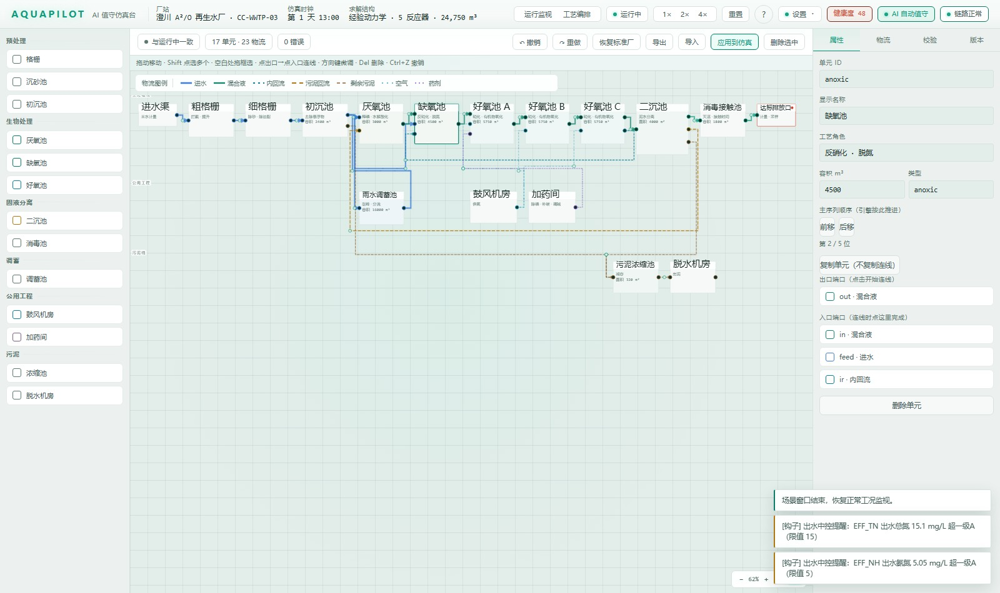
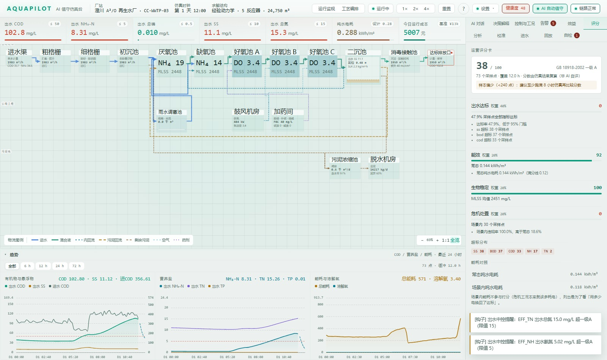

# AquaPilot

A browser-based wastewater plant simulator with an auditable AI operator.

[中文](README.zh-CN.md) · [API](docs/API.md) · [Deployment](docs/DEPLOYMENT.md) · [Benchmarks](docs/BENCHMARKS.md)

[](https://github.com/Morningstar202604/aquapilot/actions/workflows/ci.yml)
[](LICENSE)


AquaPilot lets you edit a plant flowsheet, run the process model, and hand control to an AI operator whose forecasts, decisions and guardrails all remain visible.

- **Editable plant, real process models.** Add tanks, rewire recycles, switch presets; ASM1, ASM2d, Takács and the sludge line recompile from the topology.
- **AI operator with a paper trail.** Every proposed move, declined move and guardrail block is logged; the scorecard is computed by the engine, not self-reported.
- **Industrial hooks.** Hydraulics, sensor faults, PID/interlocks, permit-style compliance reports, asset health and OPC UA / Modbus / MQTT adapters.
- **Run it anywhere.** Node.js server, CLI, single-file Windows executable, and a browser UI.


| Flowsheet editor | Operational scorecard |
| --- | --- |
|  |  |

[](docs/media/demo.mp4)

## Quick start

Requires Node.js 22.12 or newer.

```bash
npm ci
npm run build
npm start          # http://127.0.0.1:5173
```

Headless:

```bash
npm run cli -- simulate --days 7 --scenario storm
npm run cli -- bench
```

Windows single-file build: `npm run exe`.

## Scope

AquaPilot is a simulation and engineering tool, not a design-grade simulator, field control system or compliance guarantee. Model boundaries and known gaps are documented in [docs/BENCHMARKS.md](docs/BENCHMARKS.md) and [docs/PLANT-BOUNDARY.md](docs/PLANT-BOUNDARY.md).

MIT licensed.
