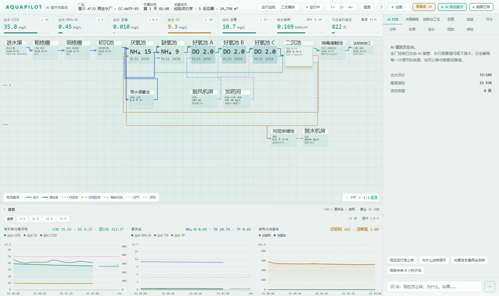
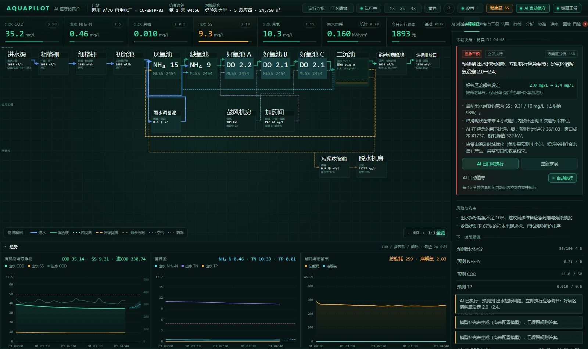

# AquaPilot

A wastewater treatment plant **simulation modelling platform**: reproducible models and experiments, end-to-end AI orchestration, multi-dimensional validation and auditable provenance.

[中文](README.zh-CN.md) · [API](docs/API.md) · [Backend modernization](docs/BACKEND-MODERNIZATION.md) · [Deployment](docs/DEPLOYMENT.md) · [Benchmarks](docs/BENCHMARKS.md)

[](https://github.com/Morningstar202604/aquapilot/actions/workflows/ci.yml)
[](LICENSE)
[](docs/BENCHMARKS.md)



AquaPilot lets you edit a plant flowsheet, run the process model, and hand control to an AI operator whose forecasts, decisions and guardrails all remain visible. Offline, an experiment is a reproducible resource: topology snapshot, seed, boundary conditions and validation report, runnable from CLI, MCP or REST.

On BSM1 Table 6, S_NH at **−10.8%** and TSS sits at **−7.4%** against the reference; [benchmarks](docs/BENCHMARKS.md) list the gates and method.

- **Editable plant, real process models.** Add tanks, rewire recycles, switch presets; ASM1, ASM2d, Takács and the sludge line recompile from the topology.
- **AI across the whole loop.** Live operation plus offline experiments where the AI closes the loop; every proposed move, declined move and guardrail block is logged.
- **High-precision, multi-dimensional validation.** Finite/non-negative samples, sampling coverage, operating compliance, COD/N/P mass balance, repeatability and step-size convergence are separate checks; model certification is distinct from this run's compliance.
- **Integrable control plane.** OpenAPI 3.1, RFC 9457, idempotent creation, ETag, a durable experiment queue and MCP experiment tools for external agents.
- **Run it anywhere.** Node.js server, CLI, single-file Windows executable, and a browser UI.



| Flowsheet editor                    | Operational scorecard                  |
| ----------------------------------- | -------------------------------------- |
|  |  |

[](docs/media/demo.mp4)

## Reproducible experiments

```bash
# One-day experiment with repeatability + 1/2-min step convergence
npm run cli -- experiment --minutes 1440 --validation full

# Seven-day storm, AI closes the loop inside the experiment, plant boundary on
npm run cli -- experiment --days 7 --scenario storm --policy ai --plant --json
```

Batch studies:

```bash
# 2 variants × 2 replicates, ranked by cost and effluent ammonia, with a Pareto front
npm run cli -- study --file study.json
```

REST control plane: `POST /api/v1/experiments` and `POST /api/v1/studies` return `202 + Location`; poll detail, download CSV/report, contract at `GET /api/openapi.json`.

## Quick start

Requires Node.js 22.12 or newer.

```bash
npm ci
npm run build
npm start          # http://127.0.0.1:5173
```

Headless:

```bash
npm run cli -- simulate --days 7 --scenario storm
npm run cli -- experiment --minutes 1440 --validation full --standard gb18918-1b
npm run cli -- bench
```

Windows single-file build: `npm run exe`; the output is `dist/aquapilot.exe`.

## Scope

AquaPilot is a simulation and engineering tool, not a design-grade simulator, field control system or compliance guarantee. Model boundaries and known gaps are documented in [docs/BENCHMARKS.md](docs/BENCHMARKS.md) and [docs/PLANT-BOUNDARY.md](docs/PLANT-BOUNDARY.md).

MIT licensed.
