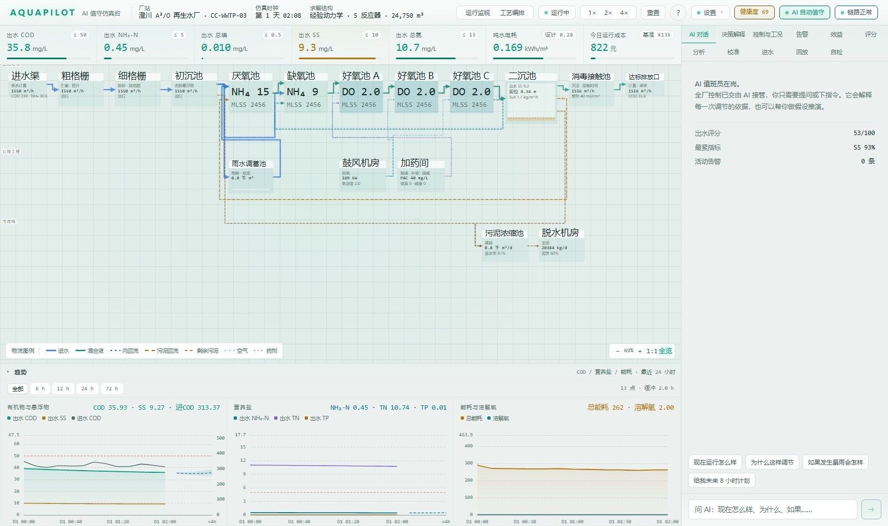
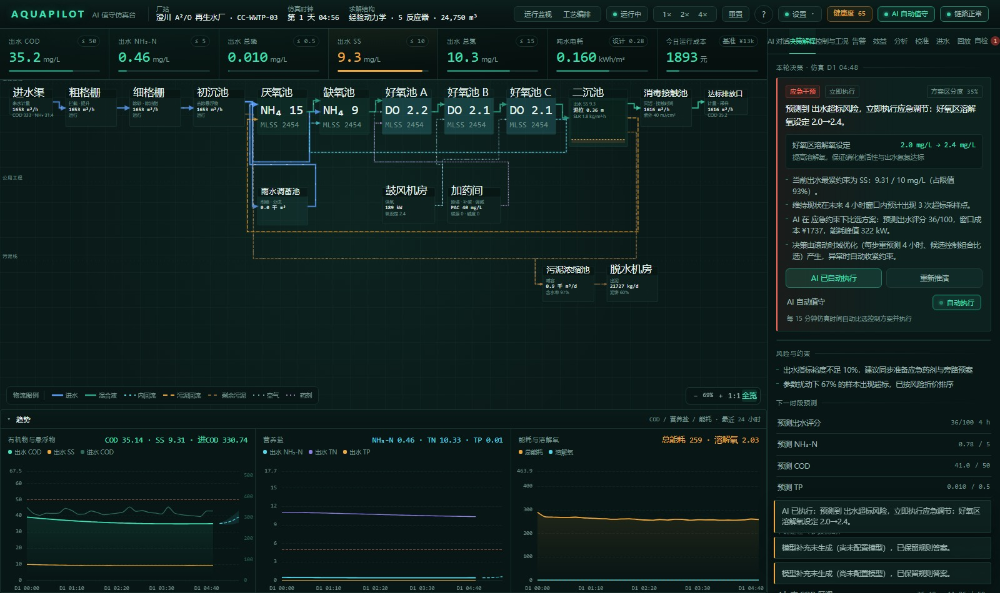
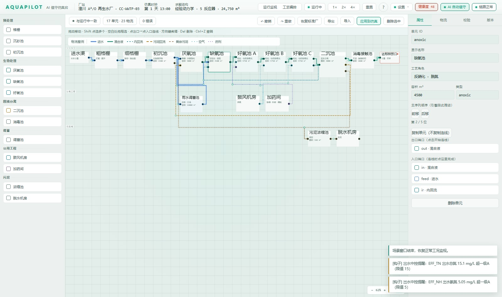
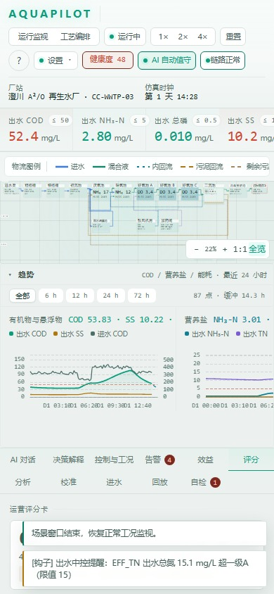
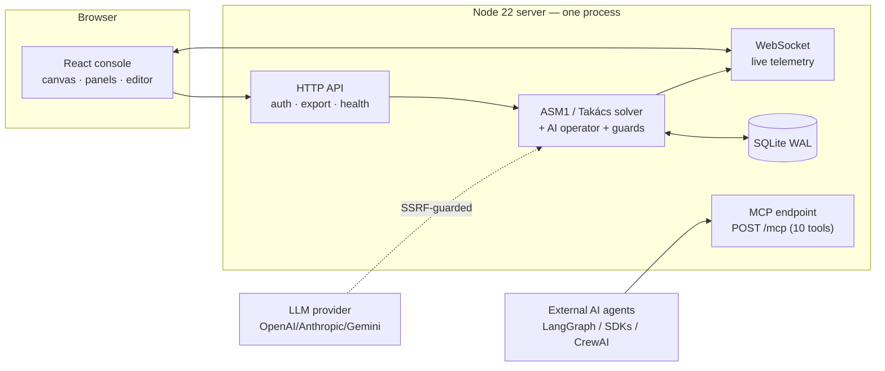

# AquaPilot

**AI-operated wastewater process simulation.** Edit the flowsheet, watch the plant run, and let an auditable AI operator hold the controls — every forecast, decision and guardrail is inspectable in the browser.

[中文说明](README.zh-CN.md) · [API](docs/API.md) · [Benchmarks](docs/BENCHMARKS.md) · [Deployment](docs/DEPLOYMENT.md)

[](https://github.com/Morningstar202604/aquapilot/actions/workflows/ci.yml)
[](https://github.com/Morningstar202604/aquapilot/actions/workflows/codeql.yml)
[](package.json)
[](LICENSE)
[](docs/BENCHMARKS.md)



## What you get

- **A plant you can edit, not a fixed diagram.** The flowsheet is a graph: add a tank, rewire a recycle, load a preset — the solver recompiles the network from the topology and the canvas follows. 17 units, 23 connections in the default A²/O plant, every edge terminating on its declared port anchor.
- **ASM1 + Takács clarifier, benchmarked.** The water train is checked against the IWA BSM1 Table 6 reference in CI; the worst deviation (TSS, the quantity affected by the Takács non-settling fraction `f_ns`) sits at **+5.1%** against the official value. ASM2d and ADM1 ship as standalone, conservation-checked modules.
- **An AI operator that shows its work.** A rolling 4-hour forecast ranks candidate control moves on compliance, cost and stability, applies them inside hard bounds, and explains every action — including the moves it *declined* and why. A guard-blocked move is reported as blocked; nothing is logged as "executed" unless a setpoint actually moved.
- **Analysis built in.** Parameter sensitivity (central differences), a compliance-vs-cost Pareto frontier, and a plant-wide COD mass-balance audit that accounts for all four destinations — effluent, waste sludge, aeration oxidation and in-system inventory.
- **Evidence, not marketing.** AI-vs-fixed-strategy shadow runs share seed, influent and initial state; the insights panel shows the real deltas. Parameter calibration and a six-state EKF ship as experimental, clearly-labelled tools.
- **Speaks MCP.** `POST /mcp` exposes the simulator to the whole agent ecosystem (LangGraph, OpenAI Agents SDK, CrewAI, Vercel AI SDK, Mastra — a Streamable HTTP URL is all they need): ten tools with JSON-Schema inputs, tiered token auth, rate limiting and origin checks. Point an agent at it and it can read the plant, inject a storm, and ask "what if DO goes to 3?" via the pure-compute `simulate_headless` tool.
- **CLI and a single-file exe.** `aquapilot simulate --days 7 --scenario storm` runs headless with a GB-18918 compliance summary; `bench` gates against BSM1 Table 6; `report` emits Markdown; `serve` starts the full stack. `npm run exe` packs it into a ~84 MB standalone `aquapilot.exe` — no Node installation required.
- **Operations-grade hygiene.** Three-tier token access (`viewer`/`operator`/`admin`), SSRF-guarded outbound fetches, SQLite history with backup/restore, Prometheus metrics, CSV replay with data-quality rejection, and an 11-step local CI gate mirrored on GitHub Actions, GitCode and Gitee.

**What it is not:** a design-grade simulator, a field control system, or a compliance guarantee. Simulation output is for testing and engineering discussion; the precise boundaries are listed in [docs/BENCHMARKS.md](docs/BENCHMARKS.md).

## Screenshots

| Control room | AI decision trail |
| --- | --- |
|  |  |
| **Flowsheet editor** | **Mobile** |
|  |  |

More views: [AI chat](docs/screenshots/02-chat.jpg) · [scenario injection](docs/screenshots/04-control.jpg) · [alarms](docs/screenshots/10-alarms.jpg) · [replay](docs/screenshots/06-replay.jpg) · [insights](docs/screenshots/05-insights.jpg) · [laptop layout](docs/screenshots/08-laptop.jpg) — or watch `docs/media/demo.mp4` / `demo.gif`.

## Quick start

Requires **Node.js 22.12+** (24 recommended). No external database or services — history uses the SQLite module built into Node.

```bash
npm ci
npm run build
npm start                 # → http://127.0.0.1:5173
```

Or without Node at all — a self-contained Windows binary:

```bash
npm run exe               # → dist/aquapilot.exe (~84 MB, SEA single file)
distquapilot.exe serve --port 5173
```

Headless / scripting via the CLI:

```bash
npm run cli -- simulate --days 7 --scenario storm --csv week.csv
npm run cli -- bench      # BSM1 Table 6 reference gates
```

Architecture:



Development mode with hot reload:

```bash
npm run dev               # Vite client on :5174, proxying API/WS to :5173
```

Verification (what CI runs):

```bash
npm run verify            # typecheck + lint + 1208 tests + build
npm run ci                # full 11-step gate: coverage, smoke, secrets, backup, audit
npm run e2e               # Playwright browser smoke (uses a system Edge/Chromium when present)
```

Docker:

```bash
docker build -t aquapilot:local .
docker run --rm -p 5173:5173 \
  -e AQUAPILOT_TOKEN="$AQUAPILOT_TOKEN" \
  -v aquapilot-data:/app/data aquapilot:local
```

## Configuration

Everything works with zero configuration — no tokens means a local, unauthenticated sandbox. Tokens turn on access control:

```text
HOST=127.0.0.1                 # non-loopback values require a token (fail-closed)
AQUAPILOT_TOKEN=...            # admin — models, agent, topology, calibration
AQUAPILOT_OPERATOR_TOKEN=...   # operator — scenarios, control adjustments
AQUAPILOT_VIEWER_TOKEN=...     # viewer — read-only wall display
AQUAPILOT_DB=data/aquapilot.db # history location (node:sqlite, WAL)
```

LLM providers (OpenAI-compatible, Anthropic Messages, Google Gemini) are configured in the UI and stored with restricted file permissions; the AI layer is optional and degrades to a deterministic rule engine without one. Full variable list: [.env.example](.env.example) · deployment details: [docs/DEPLOYMENT.md](docs/DEPLOYMENT.md).

## Documentation

| Doc | Contents |
| --- | --- |
| [docs/API.md](docs/API.md) | HTTP + WebSocket contracts, message schemas |
| [docs/BENCHMARKS.md](docs/BENCHMARKS.md) | Every measured claim, with the command that reproduces it |
| [docs/RUNBOOK.md](docs/RUNBOOK.md) | Operations, backup/restore, troubleshooting |
| [docs/DEPLOYMENT.md](docs/DEPLOYMENT.md) | Docker, persistence, reverse proxy, mirror layout |
| [docs/UI-ARCHITECTURE.md](docs/UI-ARCHITECTURE.md) | Frontend module map and data flow |
| [docs/AGENT-HARNESS.md](docs/AGENT-HARNESS.md) | Agent-protocol research (MCP/A2A) and what shipped from it |
| [docs/REFERENCE-LEARNING.md](docs/REFERENCE-LEARNING.md) | 14 peer open-source projects studied, and where each lesson landed |
| [docs/QUALITY-ROADMAP.md](docs/QUALITY-ROADMAP.md) | Known model limitations and the plan for them |
| [docs/COMPETITIVE-ANALYSIS.md](docs/COMPETITIVE-ANALYSIS.md) | Verified comparison against seven peer projects |
| [CONTRIBUTING.md](CONTRIBUTING.md) | Branches, commit style, the local gate, release steps |

## Contributing

PRs welcome. `npm run ci` is the contract: it runs the same 11 steps locally that CI runs remotely, so a green local gate is a green remote gate. See [CONTRIBUTING.md](CONTRIBUTING.md) for branch naming, commit style and the release checklist.

## License

[MIT](LICENSE)
