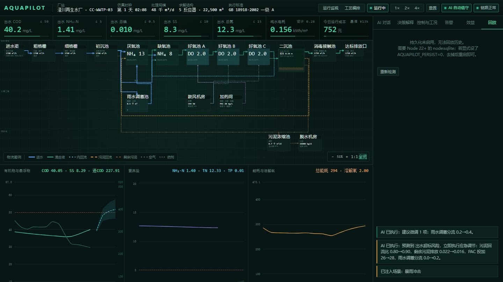

# AquaPilot

**English** · [中文](README.zh-CN.md)

> An AI-operated wastewater treatment plant simulator.  
> The plant is a graph, the graph is the model, and an AI operator runs it.

[](tests)
[](vitest.config.ts)
[](tsconfig.json)
[](LICENSE)
[](package.json)
[](https://github.com/Morningstar202604/aquapilot/releases/tag/v0.3.0)
[](https://github.com/users/Morningstar202604/packages/container/package/aquapilot)


AquaPilot is a runnable product prototype for a different division of labour in
process simulation: instead of an engineer reading curves and turning knobs, an
AI operator watches the plant, forecasts, decides and acts — while the human asks
questions and sets boundaries. The flowsheet is not a drawing: it compiles into
reactors, is solved topologically, and every number on screen comes from that
solve.

---

## Why

Commercial simulators (GPS-X, BioWin, Aspen HYSYS, SIMBA#) are powerful but assume
the operator *is* the process engineer. AquaPilot inverts that assumption and
keeps the auditable parts:

| Traditional simulator | AquaPilot |
|---|---|
| Engineer configures the flowsheet | Engineer draws the plant, the solver compiles it |
| Engineer reads trends | AI explains every decision with numbers |
| Engineer tunes setpoints | AI proposes, hard guardrails constrain, human can override |
| Offline design study | Live operation with scenario injection and replay |
| Single point forecast | Fixed-perturbation ensemble with P10–P90 bands |

## What it does

- **Topology-driven solving.** Edit the flowsheet; the engine compiles it into
  reactors, orders them topologically and solves it. Add a tank and the engine
  really solves one more tank — not a hard-coded five.
- **Real process models.** ASM1 (13 components / 8 processes) with exact
  stoichiometric conservation, plus a Takács ten-layer secondary clarifier. The
  open-loop BSM1 configuration is compared against the official Table 6 steady
  state in CI (`tests/bsm1-benchmark.test.ts`).
- **AI operator with guardrails.** Every 15 simulated minutes it forecasts four
  hours ahead, scores ~20 candidate control moves against compliance margin, cost
  and stability, then applies the best one inside hard guardrails.
- **Robust decisions.** Shortlisted candidates are re-evaluated under a fixed
  parameter-perturbation ensemble (inflow ±15 %, COD/NH₄ ±20 %, TP ±15 %,
  water temperature ±1.5 °C, biomass ±10 %). The recommendation carries an
  exceedance probability and a P10/P50/P90 band; the ranking is risk-adjusted.
- **Shadow benchmark.** A second plant runs the same seed, same influent and same
  initial state under a fixed manual strategy, so the Benefits panel compares
  strategy — not initial conditions — live.
- **Explainable by construction.** Every recommendation carries the predicted
  effluent, the candidate ranking, a per-tweak reason and a separation figure
  (explicitly *not* a probability).
- **Scenario injection.** Storm, shock load, toxicity, blower failure, RAS
  failure, power outage, winter, chemical shortage.
- **Operations surface.** Prometheus metrics, structured JSON logs, deep health
  checks, backup/restore, replay, CSV export and a one-page Markdown shift report.
- **Alarm attribution and plant health.** Every active alarm carries a unit, a
  likely cause, an executable action and a trend-extrapolated consequence; a
  five-part weighted health score (effluent margin, DO, SRT, clarifier, alarms)
  is shown in the top bar and in the alarm panel.

## Demo


_A 30-second walk-through: live flowsheet, AI conversation, decision explanation,
control and scenario injection, benefit comparison, replay, flowsheet editor._

[MP4 version](docs/media/demo.mp4) · [full-size screenshots](docs/screenshots)

| Run monitoring | AI conversation |
|---|---|
|  |  |

| Decision explanation | Control & scenarios |
|---|---|
|  |  |

| Benefit comparison | History replay |
|---|---|
|  |  |

| Alarm attribution & health | Flowsheet editor | Mobile |
|---|---|---|
|  |  |  |

| Desktop, 16:9 |
|---|
|  |

## Quick start

```bash
npm ci
npm run build
npm start          # http://127.0.0.1:5173
```

Development with hot reload:

```bash
npm run dev        # client on :5174, server on :5173
```

Verify everything the CI runs:

```bash
npm run typecheck  # TypeScript strict + noUnusedLocals/Parameters
npm run lint       # ESLint 9
npm run format     # Prettier 3 check
npm run test       # 381 tests
npm run build      # client bundle + server bundle
npm run verify     # typecheck + lint + test + build
npm run ci         # full gate: deps, types, tests, build, smoke, audit, hygiene
npm run e2e        # Playwright browser smoke against the production build
```

With Docker (published image, `linux/amd64`):

```bash
docker run --rm -p 5173:5173 -v aquapilot-data:/app/data ghcr.io/morningstar202604/aquapilot:v0.3.0
```

Or build locally:

```bash
docker build -t aquapilot:local .
docker run --rm -p 5173:5173 -v aquapilot-data:/app/data aquapilot:local
```

Optional access control and optional LLM dialogue are environment-only and
documented in [.env.example](.env.example):

```bash
AQUAPILOT_TOKEN=...            # require a bearer token on /api/* and the WS handshake
AQUAPILOT_LLM_BASE_URL=...     # any OpenAI-compatible endpoint
AQUAPILOT_LLM_MODEL=...
AQUAPILOT_LLM_API_KEY=...
```

## Architecture

```
src/
  model/         Process topology (single source of truth)
    topology.ts    units, ports, streams, validation, run-readiness
    layout.ts      automatic layout: main line, utilities, sludge line, recycles
    presets.ts     runnable plant templates derived from the standard topology
  sim/           Simulation engines
    kinetics.ts    single source for kinetic constants and tariffs
    alarmAttribution.ts  alarm cause/action/consequence and the health score
    network.ts     topology -> compiled network, topological order, flow solving
    networkEngine.ts  production engine: N reactors driven by the topology
    engine.ts      reference engine: fixed five-tank, used for calibration/regression
    asm1.ts        ASM1: 13 components, 8 processes, stoichiometry from parameters
    asm1Cstr.ts    single-CSTR solver for ASM1 verification
    takacs.ts      Takács ten-layer secondary clarifier
    ensemble.ts    fixed-perturbation ensemble, P10/P50/P90 bands
    metrics.ts     shared pure helpers (scoring, margins, clamping)
    plantTypes.ts  shared value types
  ai/            Decision layer
    agent.ts       rolling-horizon forecasting, candidate scoring, guardrails, Q&A
    llm.ts         optional OpenAI-compatible dialogue with numeric grounding
  server/        WebSocket simulation loop, REST API, static hosting
    benchmark.ts   shadow plant: AI vs fixed strategy on the same influent
    export.ts      CSV / Markdown report generation
    trendCursor.ts incremental trend cursor (ring-buffer safe)
  client/        Control-room UI (React + ECharts + SVG flowsheet)
  shared/        Client/server protocol
tests/           381 tests: physics, conservation, guardrails, topology,
                 cross-engine, benchmarks, input validation, crash boundaries
```

### The three-layer contract

```
topology  →  layout  →  render
    ↘
     solve
```

The renderer holds no process knowledge. It draws whatever state the solver
produced. This prevents the classic failure where the picture looks right but the
numbers are wrong.

### Why the trend cursor exists

The UI receives incremental patches, not full snapshots (240 KB → ~2 KB per
frame). The first implementation used "number of received points" as the cursor.
Once the 720-point ring buffer filled, the slice was always empty and every
client's chart froze silently while the simulation kept running. The cursor is now
a timestamp (`src/server/trendCursor.ts`) with a regression test that rolls the
buffer.

## What actually runs

Every claim below is reproducible from the repository.

### BSM1 Table 6 benchmark (open loop, steady state)

`npx vitest run tests/bsm1-benchmark.test.ts` — five-tank BSM1 configuration,
Qintr = 55 338 m³/d, KLa 240/240/84 d⁻¹, Henze-1987 parameter set:

| Metric | This engine | Official Table 6 | Deviation | Gate |
|---|---:|---:|---:|---|
| S_S | 0.866 | 0.889 | −2.6 % | ±10 % |
| S_NO | 11.18 | 10.415 | +7.4 % | ±10 % |
| S_NH | 1.393 | 1.733 | −19.6 % | ±25 % (known settler limit) |
| S_ALK | 4.05 | 4.13 | −2.0 % | ±10 % |
| S_O | 0.53 | 0.491 | +7.6 % | ±10 % |
| X_B,A | 155 | 152–154 (closed-loop range) | same order | informational |

The S_NH gap is 0.34 gN/m³ absolute — under 1 % of the nitrogen flux — and shares
its root cause with the settler's known TSS deviation.

### AI vs fixed strategy, same influent

`npx tsx scripts/prove-benchmark.ts` — two simulated days, seed 20261019, 96
decision cycles, shadow plant shares seed and influent:

| Metric | AI operator | Fixed strategy | Delta |
|---|---:|---:|---:|
| Effluent compliance rate | 92.3 % | 56.7 % | +35.6 pp |
| Specific energy | 0.150 kWh/m³ | 0.159 kWh/m³ | −5.6 % |
| Cost per m³ | ¥0.1420 | ¥0.1963 | −27.7 % |
| Mean effluent score | 57.8 | 46.4 | +11.3 |

The fixed strategy is a plausible conservative operating point, not a strawman:
DO 2.0 mg/L, internal recycle 2.0×Q, RAS 0.8×Q, WAS 2.2 %, PAC 40 mg/L, step feed
0.3×Q. Both sides start from the same 30-day warm-up.

### Topology really changes the physics

`npx tsx scripts/prove-network-solving.ts` and `scripts/prove-topology-matters.ts`:

| Change | Result |
|---|---|
| Add one anoxic tank | 5 → 6 reactors, TN 9.74 → 9.15 mg/L |
| Add two aerobic tanks | 7 reactors, NH₄ 0.03 mg/L |
| Keep only one aerobic tank | 3 reactors, NH₄ 7.01 mg/L (exceeds limit) |
| Aerobic volume ×2 | NH₄ 0.074 → 0.034 mg/L |
| Aerobic volume ÷2 | NH₄ 0.074 → 1.149 mg/L |
| Clarifier area ×2 | blanket 1.15 → 0.66 m |

### Engineering numbers

| Item | Measured | Command |
|---|---|---|
| Single 1-min step | 0.003 ms | `npx tsx scripts/bench.ts` |
| One 4-hour forecast | 1.4 ms | same |
| Decision, production engine (nominal) | 153 ms | same |
| Decision, production engine (robust, 3 candidates × 3 samples) | 215 ms | same |
| 30-day warm-up | ~110 ms | same |
| Tests | 381 passing | `npm test` |
| Coverage | 95.5 % lines / 83.0 % branches | `npx vitest run --coverage` |

## How the AI decides

1. **Forecast.** Run a baseline four-hour forecast from the current state.
2. **Generate candidates.** Step each control variable up and down at two
   amplitudes, plus energy-saving and compliance-first combinations (~20 in total).
3. **Score.** Compliance violation penalties dominate; margin shortfall is a medium
   penalty; cost and control movement are light penalties; SRT deviation and
   process guardrails add their own terms.
4. **Robust pass.** Re-run the top three plus *hold* under three fixed
   parameter-perturbation members; subtract exceedance and tail penalties; choose
   only among evaluated candidates. A candidate must never win by being unmeasured.
5. **Explain.** Return the chosen controls, per-tweak reasons, candidate ranking,
   predicted effluent, risks and separation; the ensemble band and exceedance
   probability travel with the recommendation.

Guardrails are hard constraints applied before scoring: DO floor, PAC floor, RAS
floor, WAS window, SRT window — each has scenario-specific tightening.

## Comparison

Details and sources: [docs/COMPARISON.md](docs/COMPARISON.md) (queried 2026-10-24).

| Project | Stars | License | Model depth | Live UI | AI operator | Topology editing |
|---|---:|---|---|---|---|---|
| **AquaPilot** | — | MIT | ASM1 + Takács + BSM1 gate | Yes | Yes | Yes |
| [fau-evt/bsm2-python](https://github.com/fau-evt/bsm2-python) | 44 | BSD-3 | BSM1/BSM2, ADM1 | No | No | No |
| [toogad/PooPyLab_Project](https://github.com/toogad/PooPyLab_Project) | 79 | GPL-3.0 | ASM family, steady state | No | No | Diagram files |
| [modelica-3rdparty/WasteWater](https://github.com/modelica-3rdparty/WasteWater) | 75 | — | Modelica library | No | No | Modelica |
| [endearqb/AutoWaterSimu](https://github.com/endearqb/AutoWaterSimu) | 15 | NOASSERTION | ASM1/ASM3/UDM | Yes | Partial | Yes |
| [USEPA/Stormwater-Management-Model](https://github.com/USEPA/Stormwater-Management-Model) | 376 | — | Hydrology/hydraulics | Desktop | No | Network editor |

AquaPilot does not aim to replace a design-grade simulator. It aims to be the
best open demonstration of *how an AI operator, a real solver and an auditable
flowsheet fit together* — with a benchmark gate strong enough to keep the model
honest.

## Status and limits

This is a **simulation prototype**, not a system that can take over a real plant.

Verified in this repository by `npm run ci` plus `npm run e2e`:

- TypeScript strict (0 errors, including unused-code checks), ESLint 9 and
  Prettier 3 clean.
- 381 tests passing; 95.6 % line / 84.7 % branch coverage.
- Client + server production build; browser smoke asserts 7 KPI tiles, the health
  pill with 5 sub-scores, 17 nodes, 3 charts, 6 panels, no console errors, no
  connection crossing a unit body and no horizontal overflow on mobile.

Known gaps (tracked in [docs/QUALITY-ROADMAP.md](docs/QUALITY-ROADMAP.md)):

- The ten-layer settler does not build a strong concentration gradient in the
  thickening zone, so underflow concentration is lower than reality; effluent TSS
  sits below the BSM1 reference.
- ASM1 has no phosphorus; TP relies on chemical precipitation.
- The BSM1 S_NH deviation is −19.6 % (0.34 gN/m³ absolute, under 1 % of the
  nitrogen flux) and locked at ±25 %; closing it requires the settler rewrite above.
- Single user; simulation state is in memory, history is persisted to SQLite
  (Node 22+) and used for replay and export.
- Access control is opt-in and is a single shared secret, not per-user accounts.
  Use TLS and a reverse proxy in production.

## Documentation

- [HTTP API and WebSocket protocol](docs/API.md) — every endpoint, status code and frame
- [UI architecture](docs/UI-ARCHITECTURE.md) — how a flowsheet becomes a running model
- [Benchmarks](docs/BENCHMARKS.md) — measured numbers and how to reproduce them
- [Comparison](docs/COMPARISON.md) — open-source landscape and what was borrowed
- [Deployment](docs/DEPLOYMENT.md) — Docker, reverse proxy, mirrors, platforms
- [Quality roadmap](docs/QUALITY-ROADMAP.md) — measured gaps and priorities
- [SLOs](docs/SLO.md) — service level objectives and suggested alerts
- [Audit report](docs/AUDIT-REPORT.md) — independent reviews and their closure
- [Scripts](scripts/README.md) — what each helper answers
- [中文说明](README.zh-CN.md)

## Contributing

See [CONTRIBUTING.md](CONTRIBUTING.md) and [CODE_OF_CONDUCT.md](CODE_OF_CONDUCT.md).
Security reports: [SECURITY.md](SECURITY.md).

## Licence

MIT
