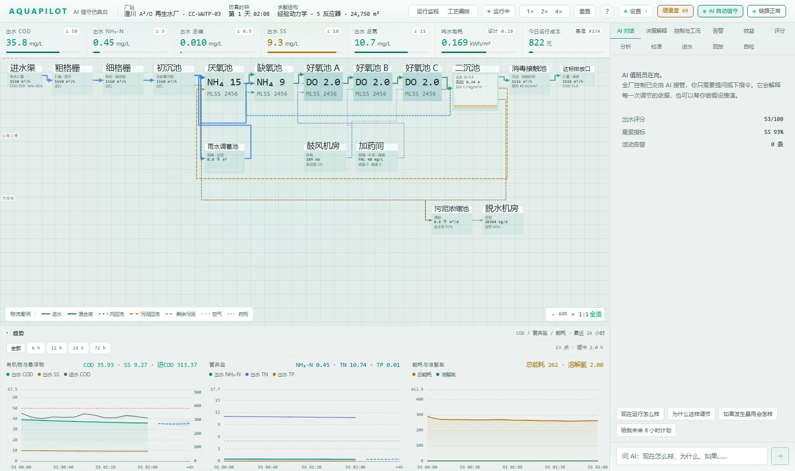
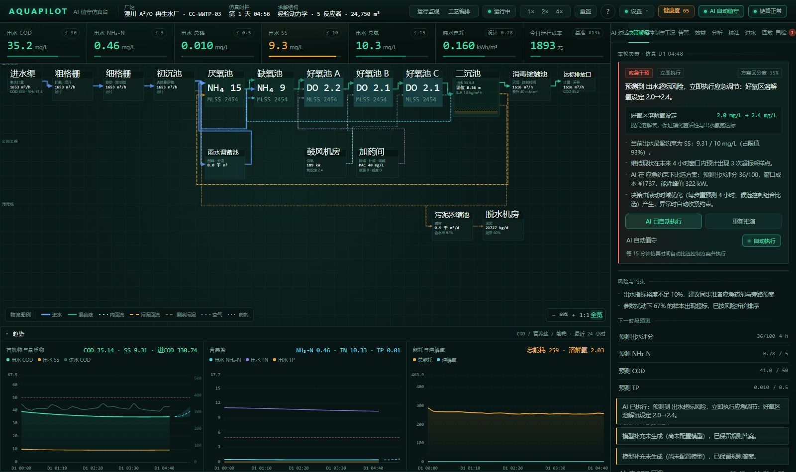
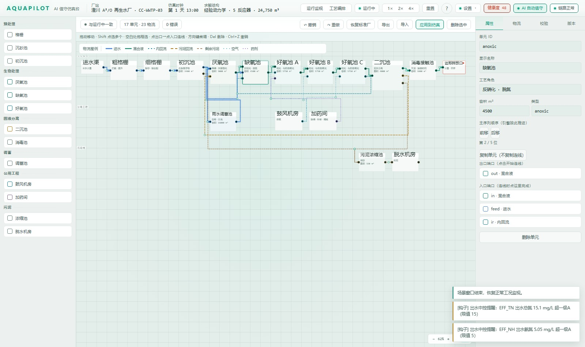
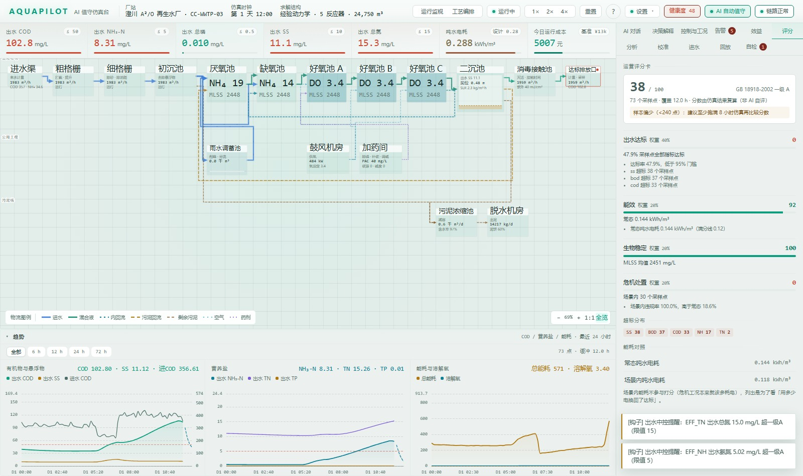

# AquaPilot

面向污水处理厂的仿真建模软件：可复现的模型与实验，AI 全流程自主编排，带多维验证与可审计 provenance。

[English](README.md) · [API](docs/API.md) · [后端现代化](docs/BACKEND-MODERNIZATION.md) · [部署](docs/DEPLOYMENT.md) · [基准](docs/BENCHMARKS.md)

[](https://github.com/Morningstar202604/aquapilot/actions/workflows/ci.yml)
[](LICENSE)



AquaPilot 可以直接改工艺流程、跑过程模型，也可以把控制权交给 AI 值守员——预测、决策和护栏都留在界面上可查。离线侧，一次实验由拓扑快照、种子、边界条件和验证报告组成，可被 CLI、MCP 或 REST 复现。

对 BSM1 Table 6，S_NH **−10.8%**、TSS 为 **−7.4%**；门槛与口径见 [基准](docs/BENCHMARKS.md)。

- **可编辑的厂，真实的过程模型。** 加池子、改回流、换模板；ASM1、ASM2d、Takács 与泥线按拓扑重新编译。
- **AI 全流程自主。** 实时值守之外，AI 可在离线实验里闭环决策；提议、拒绝、被护栏阻断的动作都留日志。
- **高精度、多维验证。** 有限性、非负、采样覆盖、运行合规、COD/N/P 三本账、重复性与步长收敛分别出结论；模型认证与本次运行合规分开表达。
- **可集成控制面。** OpenAPI 3.1、RFC 9457、幂等创建、ETag、持久实验队列，以及 MCP 实验工具；可被外部 agent 编排。
- **多种运行方式。** Node.js 服务、CLI、Windows 单文件可执行程序，以及浏览器界面。



| 工艺编排 | 运营评分卡 |
| --- | --- |
|  |  |

[](docs/media/demo.mp4)

## 可复现实验

```bash
# 1 天实验，full 校验（重复性 + 1/2 min 步长收敛）
npm run cli -- experiment --minutes 1440 --validation full

# 7 天暴雨情景，AI 在实验内闭环，开启全厂边界
npm run cli -- experiment --days 7 --scenario storm --policy ai --plant --json
```

批量研究：

```bash
# 2 个变体 × 2 次重复，按成本与出水氨氮排序并给出 Pareto 前沿
npm run cli -- study --file study.json
```

REST 控制面：`POST /api/v1/experiments` / `POST /api/v1/studies` 返回 `202 + Location`；轮询详情、下载 CSV/报告，契约见 `GET /api/openapi.json`。

## 快速开始

需要 Node.js 22.12 或更高版本。

```bash
npm ci
npm run build
npm start          # http://127.0.0.1:5173
```

无头运行：

```bash
npm run cli -- simulate --days 7 --scenario storm
npm run cli -- experiment --minutes 1440 --validation full --standard gb18918-1b
npm run cli -- bench
```

Windows 单文件构建：`npm run exe`。

## 边界

AquaPilot 是仿真与工程工具，不是设计级模拟器、现场控制系统，也不构成合规保证。模型边界与已知差距见 [docs/BENCHMARKS.md](docs/BENCHMARKS.md) 与 [docs/PLANT-BOUNDARY.md](docs/PLANT-BOUNDARY.md)。

MIT 许可。
