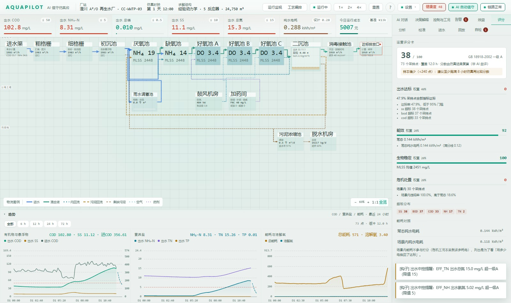
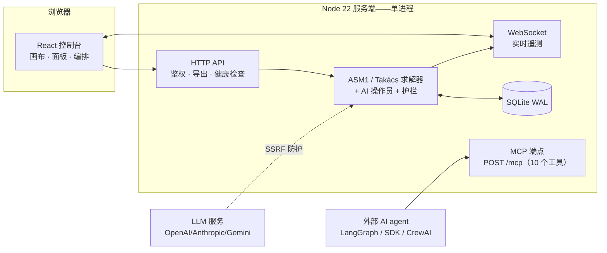

# AquaPilot

**AI 值守的污水处理工艺仿真。** 工艺流程可以随手改，改完立即重算；AI 值守员接管控制，但每一次预测、每一个决策、每一条护栏都在浏览器里可查。

[English](README.md) · [API](docs/API.md) · [基准数据](docs/BENCHMARKS.md) · [部署](docs/DEPLOYMENT.md)

[](https://github.com/Morningstar202604/aquapilot/actions/workflows/ci.yml)
[](https://github.com/Morningstar202604/aquapilot/actions/workflows/codeql.yml)
[](package.json)
[](LICENSE)
[](docs/BENCHMARKS.md)


## 你能得到什么

- **改得动的工艺流程，不是画死的图。** 流程就是一张图：加一个池子、改一根回流、切一个模板，求解器按拓扑重新编译网络，画布跟着变。默认 A²/O 厂 17 个单元、23 条连线，每条线都落在端口锚点上。
- **ASM1 + Takács 沉淀池，有基准背书。** 水线在 CI 里对照 IWA BSM1 Table 6 官方值；偏差最大的 TSS（受 Takács 非沉降分数 `f_ns` 影响）为 **+5.1%**。ASM2d 与 ADM1 作为独立、经过组分守恒校验的模块交付。
- **把自己的 reasoning 摊开的 AI 值守员。** 滚动 4 小时预测对候选控制动作按达标、成本、稳定性排序，在硬边界内执行，并解释每个动作——包括它**没动**的动作和原因。被护栏挡住的调节会如实说「被挡住」；没有任何一条日志会在控制量真的没动的情况下写「已执行」。
- **分析内建。** 参数灵敏度（中心差分）、达标-成本 Pareto 前沿、覆盖四路去向（出水 / 排泥 / 曝气氧化 / 系统内库存变化）的全厂 COD 质量平衡审计。
- **可以拿去争论的评分卡。** 每次运行按四个加权维度打分——出水达标（40）、能效（20）、生物稳定（20）、危机处置（20）——分数由引擎复算，不由 AI 自报（参考基准实测 AI 自评会把分数高估 20 分）。每个维度列出扣分依据，评分卡同时写明按哪套排放口径判读：GB 18918-2002 一级 A、一级 B 或 IWA BSM1 基准。`aquapilot scorecard` 用标准 30 天危机脚本（暴雨 / 高负荷 / 毒性 / 低温 / 鼓风机故障 / 药剂短缺）跑完整流程，不到 1 秒。
- **人的处置也留痕。** 采纳建议、拒绝建议（可带理由）、AI 自动执行，是三种不同的审计记录——`GET /api/history/reviews` 与 `reviews.csv` 把它们和决策日志并列导出。一条没人跟进的建议，从此不再与被操作员明确否决的建议混为一谈。
- **证据，不是话术。** AI 与固定策略影子双跑共享 seed、进水与初始状态；效益页展示的是真实差值。参数校准与六维 EKF 作为实验性工具随仓库交付，边界写明。
- **说 MCP 协议。** `POST /mcp` 把仿真器接入整个 agent 生态（LangGraph、OpenAI Agents SDK、CrewAI、Vercel AI SDK、Mastra——都只要一个 Streamable HTTP URL）：11 个带 JSON Schema 输入的工具、分级令牌鉴权、限流与 Origin 校验。agent 可以读厂、注暴雨、用纯计算的 `simulate_headless` 问「DO 提到 3 会怎样」。
- **CLI 与单文件 exe。** `aquapilot simulate --days 7 --scenario storm` 离线仿真并输出 GB-18918 达标汇总；`bench` 对照 BSM1 Table 6 基准；`report` 输出 Markdown 报告；`serve` 启动完整服务。`npm run exe` 打出 ~84 MB 的独立 `aquapilot.exe`——无需安装 Node。
- **键盘与读屏可用。** 侧栏 11 个页签遵循 WAI-ARIA Tabs 规范：roving tabindex、方向键与 Home/End 导航、每个页签带 `aria-controls`、每个视图有带标签的 `tabpanel`。浏览器冒烟测试里断言，不只写在单测里。
- **运维级卫生。** 三档令牌访问（`viewer` / `operator` / `admin`）、出站请求 SSRF 防护、SQLite 历史 + 备份恢复、Prometheus 指标、带数据质量拒绝的 CSV 进水回放，以及一条本地 11 步 CI 门禁，在 GitHub Actions、GitCode、Gitee 三端等价执行。

**它不是**：设计级模拟器、现场控制系统、合规保证。仿真输出只用于测试与工程讨论；精确边界见 [docs/BENCHMARKS.md](docs/BENCHMARKS.md)。

## 界面截图

| 控制室 | AI 决策链 |
| --- | --- |
|  |  |
| **运营评分卡** | **工艺编排** |
|  |  |
| **移动端** | **告警与健康度** |
|  |  |

更多视图：[AI 对话](docs/screenshots/02-chat.jpg) · [工况注入](docs/screenshots/04-control.jpg) · [回放](docs/screenshots/06-replay.jpg) · [效益](docs/screenshots/05-insights.jpg) · [笔记本布局](docs/screenshots/08-laptop.jpg)，演示视频见 `docs/media/demo.mp4`（656 kB）/ `demo.gif`（3 MB）。

## 快速开始

需要 **Node.js 22.12+**（推荐 24）。无需外部数据库或服务——历史持久化使用 Node 内置 SQLite。

```bash
npm ci
npm run build
npm start                 # → http://127.0.0.1:5173
```

也可以完全不装 Node——Windows 单文件可执行：

```bash
npm run exe               # → dist/aquapilot.exe（~84 MB，Node SEA 单文件）
dist\aquapilot.exe serve --port 5173
```

脚本化 / 无头场景用 CLI：

```bash
npm run cli -- simulate --days 7 --scenario storm --csv week.csv
npm run cli -- bench      # BSM1 Table 6 基准门禁
```

架构：



开发模式（热更新）：

```bash
npm run dev               # Vite 客户端 :5174，API/WS 代理到 :5173
```

验证（CI 同款）：

```bash
npm run verify            # 类型检查 + lint + 1343 项测试 + 构建
npm run ci                # 完整 11 步门禁：覆盖率、冒烟、密钥扫描、备份、审计
npm run e2e               # Playwright 浏览器冒烟（优先用本机 Edge/Chromium）
```

Docker：

```bash
docker build -t aquapilot:local .
docker run --rm -p 5173:5173 \
  -e AQUAPILOT_TOKEN="$AQUAPILOT_TOKEN" \
  -v aquapilot-data:/app/data aquapilot:local
```

## 配置

零配置即可运行——不配令牌就是本地无鉴权沙箱；配上令牌即启用访问控制：

```text
HOST=127.0.0.1                 # 非本机监听必须配令牌（fail-closed）
AQUAPILOT_TOKEN=...            # admin —— 模型、Agent、拓扑、校准
AQUAPILOT_OPERATOR_TOKEN=...   # operator —— 场景、控制调节
AQUAPILOT_VIEWER_TOKEN=...     # viewer —— 只读大屏
AQUAPILOT_DB=data/aquapilot.db # 历史库位置（node:sqlite，WAL）
```

LLM 服务商（OpenAI 兼容 / Anthropic Messages / Google Gemini）在界面里配置，密钥以受限文件权限落盘；AI 层可选，未配置时回退到确定性规则。完整变量清单见 [.env.example](.env.example)，部署细节见 [docs/DEPLOYMENT.md](docs/DEPLOYMENT.md)。

## 文档

| 文档 | 内容 |
| --- | --- |
| [docs/API.md](docs/API.md) | HTTP + WebSocket 契约、消息 schema |
| [docs/BENCHMARKS.md](docs/BENCHMARKS.md) | 每一条实测数字，附复现命令 |
| [docs/RUNBOOK.md](docs/RUNBOOK.md) | 运维、备份恢复、故障排查 |
| [docs/DEPLOYMENT.md](docs/DEPLOYMENT.md) | Docker、持久化、反向代理、镜像仓库布局 |
| [docs/UI-ARCHITECTURE.md](docs/UI-ARCHITECTURE.md) | 前端模块划分与数据流 |
| [docs/SECURITY-HARDENING.md](docs/SECURITY-HARDENING.md) | 已修复的安全问题、复现步骤与反证记录 |
| [docs/QUALITY-ROADMAP.md](docs/QUALITY-ROADMAP.md) | 已知模型局限与处理计划 |
| [docs/COMPETITIVE-ANALYSIS.md](docs/COMPETITIVE-ANALYSIS.md) | 对照 7 个同类项目的核实比较 |
| [CONTRIBUTING.md](CONTRIBUTING.md) | 分支、提交规范、本地门禁、发版步骤 |

## 参与贡献

欢迎 PR。`npm run ci` 就是契约：本地跑的 11 步与远程 CI 完全一致，本地绿 = 远程绿。分支命名、提交风格与发版清单见 [CONTRIBUTING.md](CONTRIBUTING.md)。

## 许可证

[MIT](LICENSE)
