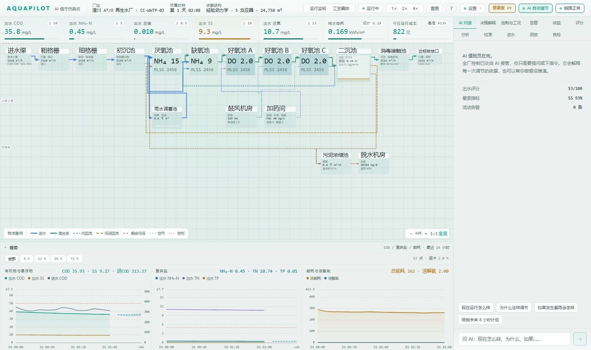
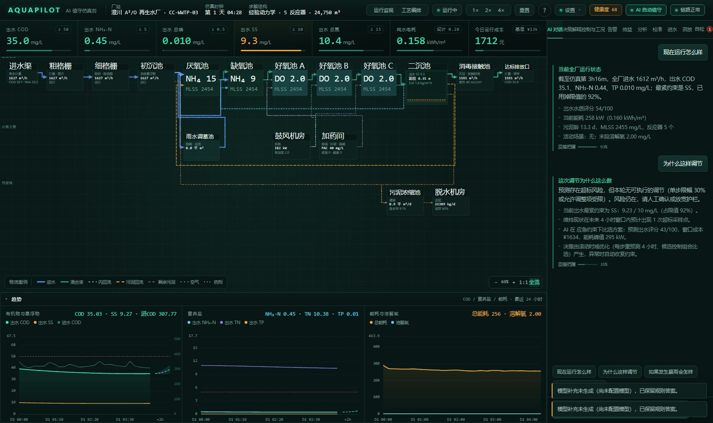
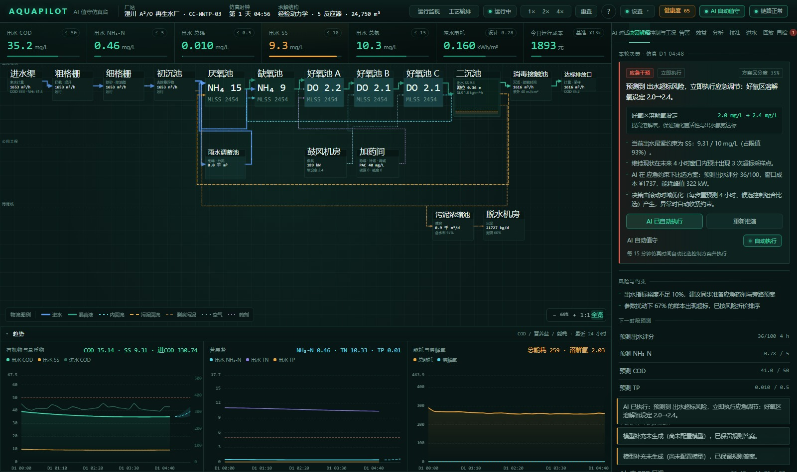
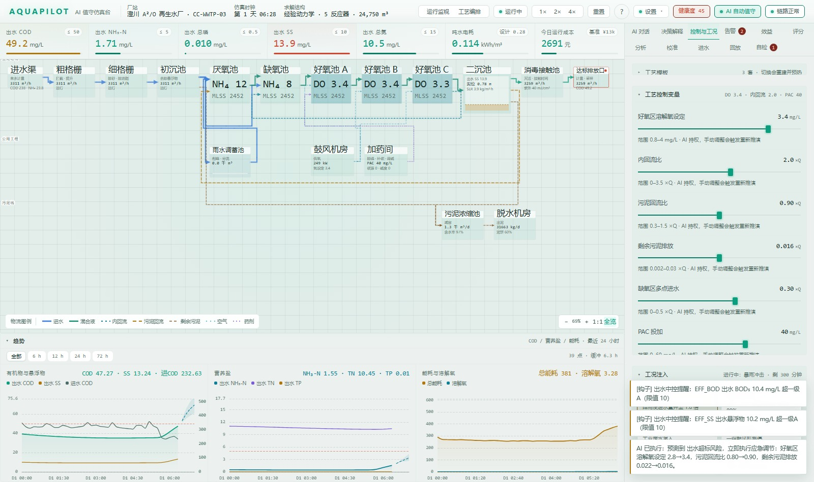
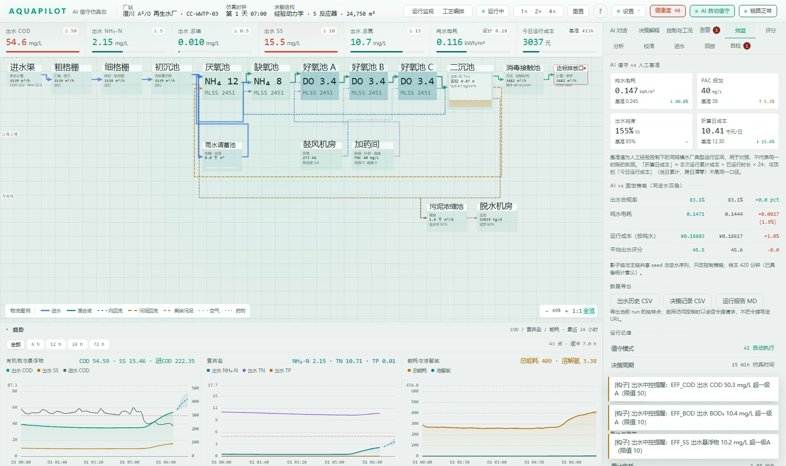
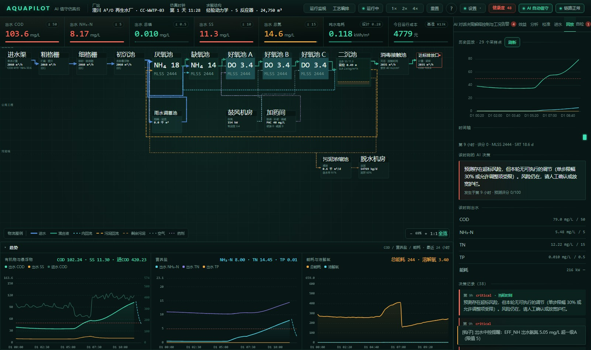
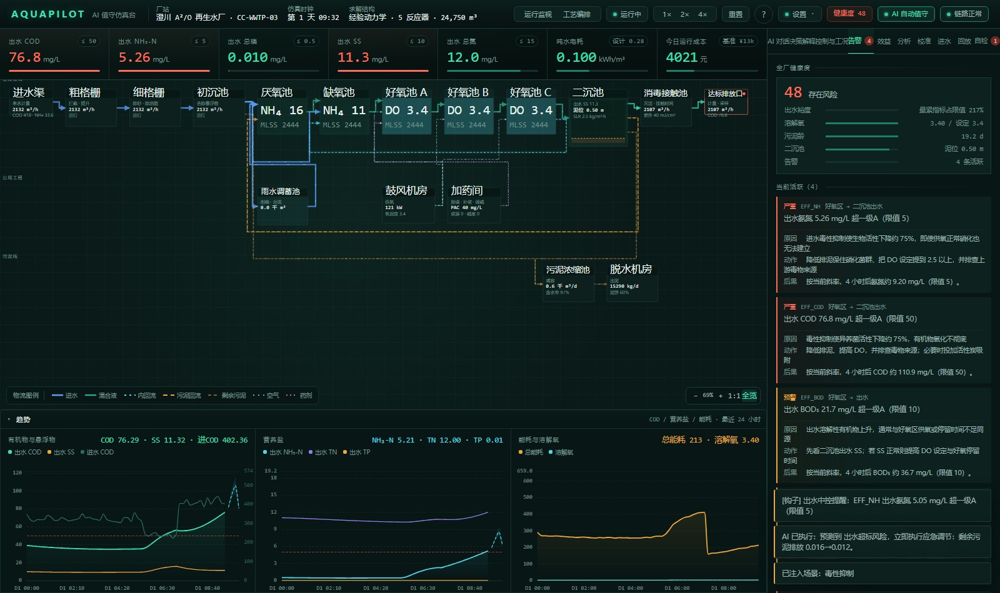
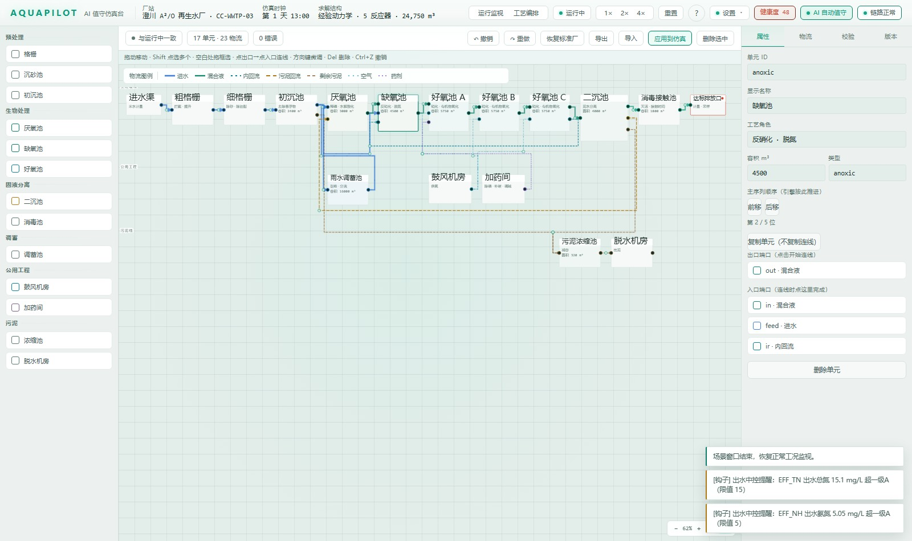
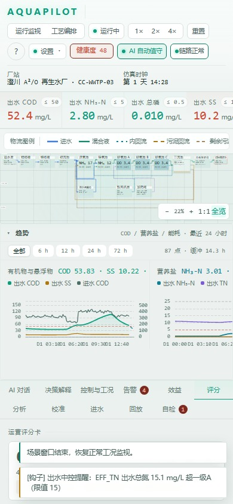

# AquaPilot

[English](README.md) · **中文**

> AI 值守的再生水厂仿真台。  
> 厂是图，图就是模型，AI 值班员来跑。

[](tests)
[](vitest.config.ts)
[](tsconfig.json)
[](LICENSE)
[](https://github.com/Morningstar202604/aquapilot/releases/tag/v0.4.0)



一个把工业仿真平台与 AI 操作员合成一体的可运行产品原型：工艺拓扑是唯一真相源，
引擎按拓扑真实求解水质演化，AI 值班员每 15 分钟做一次滚动预测、比选控制方案并在
硬护栏内执行，人只负责提问和划边界。

## 这个项目是什么 / 不是什么

这比任何功能清单都重要，因为这个项目容易被误读。

**它是**一个运行侧原型：可当作图来编辑的工艺模型、在硬护栏内决策的 AI 值守员，
以及一个能回答「哪个旋钮真的有效」「达标要花多少钱」「这些数字自洽吗」的分析面。
它的目标是**被运行、被观察、被质询**，不是产出设计报告。

**它不是**设计级工艺模拟器：没有 BSM2/ADM1，没有参数校准与状态估计链路，
没有 LCA/TEA 边界，也没有 OPC UA/Modbus 现场总线适配。
商业软件（GPS-X、BioWin、SIMBA#）与研究库（`bsm2-python`、QSDsan、PyADM1ODE）
才是干那些活的正确工具。

需要设计校核，请用设计模拟器。需要看清「AI 值守员会怎么做」并且**每一条决策都能被审计**——
那是本项目填的空白。含七个同领域项目核实事实的完整对标见
[`docs/COMPETITIVE-ANALYSIS.md`](docs/COMPETITIVE-ANALYSIS.md)。

### 差异点（具体到实现）

| 能力 | 为什么少见 |
| --- | --- |
| **图就是模型** | 流程图编译成反应器并拓扑求解。加一个池子，求解器真的多解一个池——不是写死的五个。 |
| **四道护栏的 AI** | 控制量白名单、单步幅度限幅、人工优先期、`critical` 优先于死区。预测超标永远不会被写成「工况稳定」。 |
| **构造即可解释** | 每条建议都带预测出水、候选排名、逐项理由与分离度（明确不是概率）。 |
| **影子双跑** | 第二座厂用同 seed 同进水跑固定策略，收益面板比较的是**策略**，不是初始条件。 |
| **运行期分析** | 参数灵敏度（中心差分）、达标 vs 成本的 Pareto 前沿、全厂 COD 质量平衡审计——都用控制器同一份模型。 |
| **角色而非单令牌** | `viewer` / `operator` / `admin`，值班大屏改不了设定值。 |

## 它解决什么

传统仿真平台（GPS-X、BioWin、WEST）能力强，但要求操作者自己设参数、看曲线、做判断。
这个项目换一种分工：**AI 看盘、AI 操作、人提问**。同时保留工程上真正重要的部分——
模型有出处、决策可复核、边界说得准。

| 传统仿真器     | AquaPilot                         |
| -------------- | --------------------------------- |
| 工程师搭流程   | 工程师画厂，求解器编译            |
| 工程师读曲线   | AI 用数字解释每次决策             |
| 工程师调设定值 | AI 提议、硬护栏约束、人可随时接管 |
| 离线设计研究   | 在线运行 + 工况注入 + 回放        |
| 单点预测       | 固定扰动集合，输出 P10–P90        |

## 核心能力

- **拓扑驱动求解**：改图后引擎重新编译、拓扑排序并求解。加一个池子就真的多解一个池子。
- **真实工艺模型**：ASM1（13 组分 / 8 过程）+ Takács 十层二沉池；BSM1 开环 Table 6
  稳态对照写进 CI（`tests/bsm1-benchmark.test.ts`）。
- **AI 值守与硬护栏**：每 15 分钟仿真时间做 4 小时滚动预测，在约 20 个候选控制方案中比选，
  排序后再执行；DO 下限、PAC 底线、SRT 区间等是执行前就应用的硬约束。
- **鲁棒决策**：对入围候选追加固定参数扰动集合（进水 ±15%、COD/氨氮 ±20%、总磷 ±15%、
  水温 ±1.5 ℃、生物量 ±10%），把超限概率与最差样本折进排序，随建议一起给出 P10/P50/P90 区间。
- **决策死区**：最优候选领先「维持现状」不足 18 分时选择不动——24 小时闭环实测把无意义微调
  从 34 次降到 24 次，内回流比不再在 0.8↔1.6 之间来回摆动；predicted ≥ critical 时不设死区。
- **同进水双跑**：影子厂与主厂共享 seed、进水序列和初值，只改控制策略。效益面板实时对比
  合规率、吨水电耗、吨水成本与平均出水评分。
- **可解释**：每条建议带预测出水、候选排名、逐项调节理由与方案区分度（明确标注为非概率）。
- **工况注入**：暴雨、冲击负荷、毒性抑制、鼓风机故障、回流泵故障、停电、低温、药剂短缺。
- **运营面**：Prometheus 指标、JSON 结构化日志、深健康检查、备份恢复、回放、CSV 导出与
  一页式 Markdown 值班报告。
- **告警归因与全厂健康度**：每条活跃告警都带工艺环节、原因、可执行动作与趋势外推后果；
  顶栏与告警面板展示五维加权健康度（出水裕度、溶解氧、污泥龄、二沉池、告警）。

## 演示


_30 秒走查：实时工艺图、AI 对话、决策解释、控制与工况、效益对比、回放、工艺编排。_

[MP4 版本](docs/media/demo.mp4) · [全部截图](docs/screenshots)

| 运行监视                                      | AI 对话                               |
| --------------------------------------------- | ------------------------------------- |
|  |  |

| 决策解释                                      | 控制与工况                                  |
| --------------------------------------------- | ------------------------------------------- |
|  |  |

| 效益对比                                      | 历史回放                                  |
| --------------------------------------------- | ----------------------------------------- |
|  |  |

| 告警归因与健康度                          | 工艺编排                                  | 移动端                                    |
| ----------------------------------------- | ----------------------------------------- | ----------------------------------------- |
|  |  |  |

## 快速开始

```bash
npm ci
npm run build      # 类型检查 + 前端构建 + 服务端打包
npm start          # http://127.0.0.1:5173
```

开发模式（前端热更新 + 服务端自动重启）：

```bash
npm run dev        # 前端 5174，服务端 5173
```

验证：

```bash
npm run typecheck  # TypeScript 严格模式
npm run lint       # ESLint 9
npm run test       # 855 项测试
npm run build      # 客户端 + 服务端
npm run verify     # 上述四项按顺序跑
npm run ci         # 完整门禁：依赖、类型、测试、构建、冒烟、审计、卫生
npm run e2e        # Playwright 浏览器冒烟
```

Docker（已发布镜像，`linux/amd64`）：

```bash
docker run --rm -p 5173:5173 -v aquapilot-data:/app/data ghcr.io/morningstar202604/aquapilot:v0.4.0
```

或本地构建：

```bash
docker build -t aquapilot:local .
docker run --rm -p 5173:5173 -v aquapilot-data:/app/data aquapilot:local
```

可选配置在界面顶栏 **模型设置** 里完成，也可以继续用环境变量（见 [.env.example](.env.example)）：

```bash
AQUAPILOT_TOKEN=...            # /api/* 与 WebSocket 握手需要 Bearer 令牌
AQUAPILOT_LLM_BASE_URL=...     # 界面未保存配置时的回退值
AQUAPILOT_LLM_MODEL=...
AQUAPILOT_LLM_API_KEY=...
```

### Agent 设置（角色 / 提示词 / 技能 / 钩子 / 约束 / 权限）

顶栏 **Agent 设置** 把 AI 值班员本身做成可配置对象，六个分页都可以改：

| 分页         | 内容                                                        | 生效点                                                      |
| ------------ | ----------------------------------------------------------- | ----------------------------------------------------------- |
| 角色与提示词 | 名字、职责、语气、回答长度；提示词块可启停/编辑/新增        | 合成 system prompt 发给模型；界面「预览合成提示词」可先验证 |
| 技能         | 内置 4 个（暴雨/毒性/节能/交班）+ 自定义新建 + URL 导入     | 命中触发词时正文进入 system prompt，回答下方标注命中技能    |
| 钩子         | 事件（告警/决策/对话/配置）× 动作（提示/日志/技能/Webhook） | 服务端按冷却窗口去重后执行；Webhook 仅「完全放开」权限可用  |
| 约束         | 允许的控制量、AI 单步幅度、人工确认、禁止话题               | 服务端拦截人工写入与 AI 自动执行，双通道都生效              |
| 权限与核心   | 只读 / 标准 / 完全放开；核心保护区只读展示                  | 写入时由存储层统一校验，界面绕过不了                        |

同样的事也可以用对话命令完成，例如：`设置角色 首席值班长`、`添加技能 除磷优化|除磷,总磷|1. …`、
`约束 允许控制 doSetpoint,pacSed`、`权限 完全放开`、`列出技能`、`命令`（看全部用法）。

CLI 与直接改文件也生效，服务端按 mtime 热加载：

```bash
npx tsx scripts/agent-config.ts show
npx tsx scripts/agent-config.ts set-persona --name 首席值班长 --tone 严谨详实
npx tsx scripts/agent-config.ts add-skill --name 应急降负荷 --triggers 降负荷,减产 --content "1. …"
npx tsx scripts/agent-config.ts permission open
```

配置文件 `data/agent-config.json`（0600）。核心保护区——出水限值、安全护栏、鉴权、密钥、
工艺动力学——不在可写 schema 里，任何权限、任何入口都改不到。

### 画布编排（拖拽 / 端口连线 / 单元检视）

工艺编排视图按流程模拟器的读图约定重做：

| 能力       | 做法                                                                                                                                                                                       |
| ---------- | ------------------------------------------------------------------------------------------------------------------------------------------------------------------------------------------ |
| 拖拽摆放   | 从左侧组件库拖到画布，落点吸附 14px 栅格；画布上的单元可直接拖动，坐标写进拓扑的 `positions`，撤销/重做与保存都跟着走                                                                      |
| 端口连线   | 每个单元在左右边界画出全部端口（入口青色、出口绿色）；点出口再点入口即完成连线，物流类型取目标端口的类型，重复接线在入口处直接挡住                                                         |
| 自动接线   | 新拖入的生物池（厌氧/缺氧/好氧）自动插入主序列末位与其下游之间，一次接好两条边，校验 0 错误                                                                                                |
| 自动排列   | 工具条的「自动排列」清空手工坐标与折点，回到分层自动布局；公用工程与污泥单元（鼓风机房、加药间、浓缩池）的人工坐标同样生效                                                                |
| 多选与对齐 | 空白处拖框选、Shift 点选多个；选中后一起拖动，工具条出现左/右/顶/底对齐与横/竖等距                                                                                                         |
| 键盘       | 方向键按渲染位置微调整组选中（Shift 加速 5 格）、Del 一次删除全部选中单元及其连线（单步可撤销）、Esc 取消选择、Ctrl+Z 撤销                                                               |
| 连线折点   | 每条连线在编辑模式有中点手柄：拖动即插入正交折点（存在 `topology.routes`），可继续加折点；点「×」恢复自动走线，折点随应用与重载保留                                                       |
| 拖拽连线   | 从出口圆点拖到入口圆点松手即完成连线（拖动时有橡皮筋预览）；与「点出口→点入口」共用同一套去重与流股推导                                                                    |
| 版本历史   | 每次应用/切换模板都留痕（保留最近 20 版）；「版本」页列出 revision、说明与单元/物流数，可一键回滚——回滚以旧内容创建**新** revision，并走同样的校验与 30 天预热                        |
| 单元检视   | 监视视图点任一池子，右侧浮层显示该单元的容积、实时 DO/MLSS/NH₄/NO₃、泥位、进出物流数、设备参数，并**只列它自己支持的**控制量（好氧池给溶解氧/加药，二沉池才给回流比/排泥），可直接拖动改值；主序列单元另附沿程剖面（5 级 DO/NH₄/NO₃），二沉池附十层污泥浓度剖面并标出进料层 |
| 图标       | 每个单元标题前有工艺图标（≣ 格栅、◉ 好氧、◎ 二沉、≋ 鼓风），端口按物流类型着色并带两字短标签                                                                                               |
| 折叠分组   | 侧栏控制面板按「工艺模板 / 工艺控制变量 / 工况注入」折叠，收起时标题行仍显示当前关键读数（DO、内回流、PAC、进行中的场景）                                                                  |

侧栏 **自检** 页每 10 秒展示一次服务端检查结果（仿真步进、时钟推进、步进耗时、模型链路
降级率、持久化、Agent 配置、钩子、客户端连接），异常项直接给出下一步动作。

### 自定义模型接入

顶栏 **模型设置** 是接入模型的正式入口，原生支持三种主流协议：
OpenAI 兼容（`/chat/completions` + `/models`）、Anthropic Messages、Google Gemini，
不新增任何依赖。

- 选协议、填 Base URL（常用地址一键填入）、贴 API Key。对话框会从端点实时拉取
  模型列表、自动展开供选择，并支持输入筛选。
- 上下文窗口、输出上限与能力项（工具调用 / 图像 / 推理 / 流式）按端点元数据
  自动匹配，缺失时按模型命名推断；点「自动」可切到「自定义」手动覆盖。
- **连接测试**会发一次真实对话请求，返回延迟与模型回复；失败给出可读原因
  （密钥无效、路径不对、限流、超时）。
- 保存后的配置在 `data/llm-config.json`（权限 0600），下一轮提问立即生效，无需重启。
  浏览器只拿到掩码与 `hasKey`，密钥输入框留空表示沿用已保存的密钥。

## 架构

```
src/
  model/          工艺拓扑（唯一真相源）
    topology.ts     单元、端口、物流、拓扑校验、可运行性推导
    layout.ts       自动布局（主线分层 + 公用工程 + 污泥线 + 回流绕行）
    presets.ts      由标准厂派生的可运行工艺模板
    topologyEdit.ts 批量删除、折点、绝对位移（可撤销的纯函数）
    topologyInput.ts 拓扑帧的信任边界校验（apply / 版本回滚共用）
    trainProfile.ts 检视器的主序列沿程 DO/NH₄/NO₃ 行
  sim/            仿真核心（单一引擎、单一规则；纯函数、无 IO、可确定性复现）
    kinetics.ts     动力学常数与费率的唯一出处
    alarmAttribution.ts 告警归因（原因/动作/后果）与健康度评分
    network.ts      拓扑 → 编译网络、拓扑排序、流量求解
    networkEngine.ts 生产引擎：按拓扑驱动的 N 个反应器
    asm1.ts         ASM1：13 组分 / 8 过程，化学计量由参数推导
    forcing.ts      日节律/季节性强迫、事故包络、回流降额
    alarmRules.ts   活跃告警的唯一定义
    asm1Cstr.ts     单池 CSTR 求解器
    takacs.ts       Takács 十层二沉池
    ensemble.ts     固定扰动集合预测与 P10/P50/P90
    metrics.ts      共享纯函数（评分、裕度、夹紧）
  ai/
    agent.ts        滚动时域决策、候选比选、护栏、问答
    llm.ts          可选 LLM 对话（OpenAI 兼容 + 数字白名单校验）
  server/
    benchmark.ts    影子双跑：AI vs 固定策略，同一进水
    export.ts       CSV / Markdown 报告
    trendCursor.ts  增量趋势游标（环形缓冲安全）
    tankStates.ts   分池快照行，MLSS 口径如实标注
    topologyStore.ts 生效拓扑 + 最近 20 版历史（原子写）
    index.ts        WebSocket 仿真循环、REST、静态托管
  client/           控制室界面（React + ECharts + SVG 工艺图）
  shared/           前后端消息契约、物流/单元元数据、仿真时钟格式
tests/              855 项测试：物理性质、守恒、AI 护栏、拓扑、双跑、输入校验、崩溃边界
```

### 三层契约

```
topology  →  layout  →  render
    ↘
     solve
```

渲染层不持有工艺知识，只画求解器给出的状态。这条约束防的是"图好看、数不对"。

### 趋势游标的由来

界面收的是增量补丁而不是全量快照（240 KB → 约 2 KB/帧）。第一版用"已收到的点数量"
当游标：720 点环形缓冲写满后，切片永远为空，所有客户端的曲线在后台静止。
现在游标是时间戳（`src/server/trendCursor.ts`），并有滚动缓冲的回归测试。

## 可复现的实测结论

### BSM1 Table 6 开环稳态对照

`npx vitest run tests/bsm1-benchmark.test.ts`：

| 指标  | 本引擎 | 官方 Table 6 |   偏差 | 门槛                   |
| ----- | -----: | -----------: | -----: | ---------------------- |
| S_S   |  0.866 |        0.889 |  −2.6% | ±10%                   |
| S_NO  |  11.18 |       10.415 |  +7.4% | ±10%                   |
| S_NH  |  1.393 |        1.733 | −19.6% | ±25%（沉降器已知限制） |
| S_ALK |   4.05 |         4.13 |  −2.0% | ±10%                   |
| S_O   |   0.53 |        0.491 |  +7.6% | ±10%                   |

S_NH 绝对差 0.34 gN/m³，不足氮通量的 1%，与二沉池 TSS 偏低同源。

### AI vs 固定策略（同一进水）

`npx tsx scripts/prove-benchmark.ts`：2 个仿真日、seed 20261019、96 个决策周期。

| 指标         |      AI 值守 |     固定策略 |           差值 |
| ------------ | -----------: | -----------: | -------------: |
| 出水合规率   |        94.5% |        56.7% | +37.8 个百分点 |
| 吨水电耗     | 0.151 kWh/m³ | 0.159 kWh/m³ |          −5.0% |
| 吨水成本     |      ¥0.1434 |      ¥0.1963 |         −27.0% |
| 平均出水评分 |         57.8 |         46.4 |          +11.3 |

固定策略是可辩护的保守运行点（DO 2.0、内回流 2.0×Q、RAS 0.8×Q、排泥 2.2%、
PAC 40 mg/L、多点进水 0.3×Q），两条链都从同样的 30 天预热开始。

### 改图真的改变物理

`npx tsx scripts/prove-network-solving.ts`、`scripts/prove-topology-matters.ts`：

| 改动               | 结果                              |
| ------------------ | --------------------------------- |
| 增加一个缺氧池     | 5 → 6 反应器，TN 9.74 → 9.15 mg/L |
| 增加两个好氧池     | 7 反应器，NH₄ 0.03 mg/L           |
| 只保留一个好氧池   | 3 反应器，NH₄ 7.01 mg/L（超标）   |
| 好氧池容积 ×2 / ÷2 | NH₄ 0.074 → 0.034 / 1.149 mg/L    |
| 二沉池面积 ×2      | 泥位 1.15 → 0.66 m                |

### 工程指标

| 项目                                  | 实测                  | 命令                        |
| ------------------------------------- | --------------------- | --------------------------- |
| 单步仿真（1 min，生产引擎）            | 0.012 ms              | `npx tsx scripts/bench.ts`  |
| 单次 4 h 预测                         | 3.2 ms                | 同上                        |
| 生产引擎决策（名义）                  | 105 ms                | 同上                        |
| 生产引擎决策（鲁棒，3 候选 × 3 样本） | 135 ms                | 同上                        |
| 30 天预热                             | 390 ms                | 同上                        |
| 测试                                  | 855 通过              | `npm test`                  |
| 覆盖率                                | 92.9% 行 / 82.4% 分支 | `npx vitest run --coverage` |

## AI 怎么决策

1. **预测**：从当前状态跑一次 4 小时基线预测。
2. **生成候选**：每个控制量两档升降 + 节能组合 + 达标优先组合，约 20 个。
3. **打分**：超标重罚 > 裕度不足中等罚 > 成本与频繁调整轻罚，再叠加 SRT 与工艺护栏惩罚。
4. **鲁棒复核**：对前 3 名 + 维持现状做固定扰动集合预测，按超限概率与最差样本扣分；
   最终只在被评估过的候选里选——不能让"没被评估"变成优势。
5. **解释**：给出动作、逐项理由、候选排名、预测出水、风险与区分度；区间与超限概率随建议返回。

护栏在执行前应用：DO 下限、PAC 底线、RAS 下限、排泥窗口、SRT 区间，并按场景收紧。

## 与同类项目的定位

详见 [docs/COMPARISON.md](docs/COMPARISON.md)（2026-10-24 查询）。

| 项目                                                                                      | Star | 许可        | 模型深度                  | 实时界面 | AI 操作 | 拓扑编辑 |
| ----------------------------------------------------------------------------------------- | ---: | ----------- | ------------------------- | -------- | ------- | -------- |
| **AquaPilot**                                                                             |    — | MIT         | ASM1 + Takács + BSM1 门禁 | 有       | 有      | 有       |
| [fau-evt/bsm2-python](https://github.com/fau-evt/bsm2-python)                             |   44 | BSD-3       | BSM1/BSM2、ADM1           | 无       | 无      | 无       |
| [toogad/PooPyLab_Project](https://github.com/toogad/PooPyLab_Project)                     |   79 | GPL-3.0     | ASM 系列、稳态            | 无       | 无      | 图示文件 |
| [modelica-3rdparty/WasteWater](https://github.com/modelica-3rdparty/WasteWater)           |   75 | —           | Modelica 库               | 无       | 无      | Modelica |
| [endearqb/AutoWaterSimu](https://github.com/endearqb/AutoWaterSimu)                       |   15 | NOASSERTION | ASM1/ASM3/UDM             | 有       | 部分    | 有       |
| [USEPA/Stormwater-Management-Model](https://github.com/USEPA/Stormwater-Management-Model) |  376 | —           | 水文水力                  | 桌面     | 无      | 网络编辑 |

AquaPilot 不替代设计级仿真器。它要成为的是"AI 操作员 + 真实求解器 + 可审计工艺图"
这套组合的最佳开源示范，并且用 BSM1 门禁把模型可信度钉住。

## 已知边界

这是**仿真原型**，不是可接管真实水厂的系统：

- 二沉池十层模型在浓缩区梯度不足，回流浓度低于实际；出水 TSS 低于 BSM1 参考值。
- ASM1 不含磷，总磷依赖化学沉淀。
- BSM1 的 S_NH 偏差 −19.6%（0.34 gN/m³，不足氮通量 1%），以 ±25% 锁定；
  彻底收敛需要重写二沉池数值格式。
- 单用户；仿真状态在内存，历史写入 SQLite（Node 22+）供回放与导出。
- 访问控制是单一共享令牌，不是多用户权限；生产部署需 TLS 与反向代理。

## 文档

- [HTTP API 与 WebSocket 协议](docs/API.md)
- [界面架构](docs/UI-ARCHITECTURE.md)
- [基准与实测](docs/BENCHMARKS.md)
- [同类项目对比](docs/COMPARISON.md)
- [部署](docs/DEPLOYMENT.md)
- [质量路线](docs/QUALITY-ROADMAP.md)
- [SLO](docs/SLO.md)
- [审计报告](docs/AUDIT-REPORT.md)
- [脚本说明](scripts/README.md)

## 许可证

MIT
