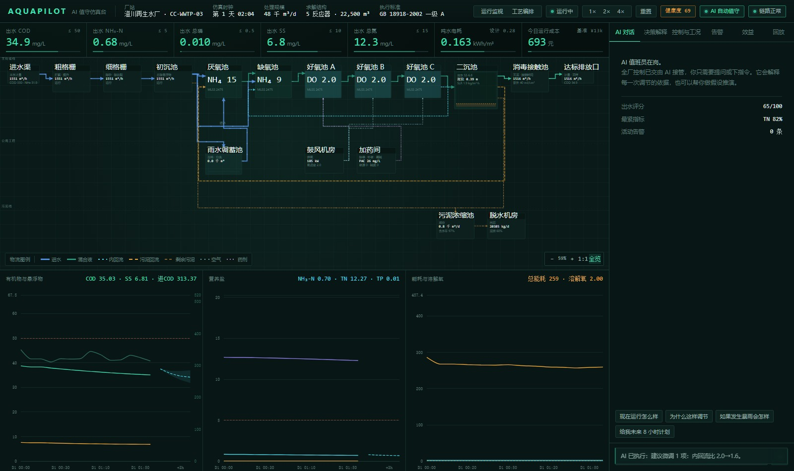
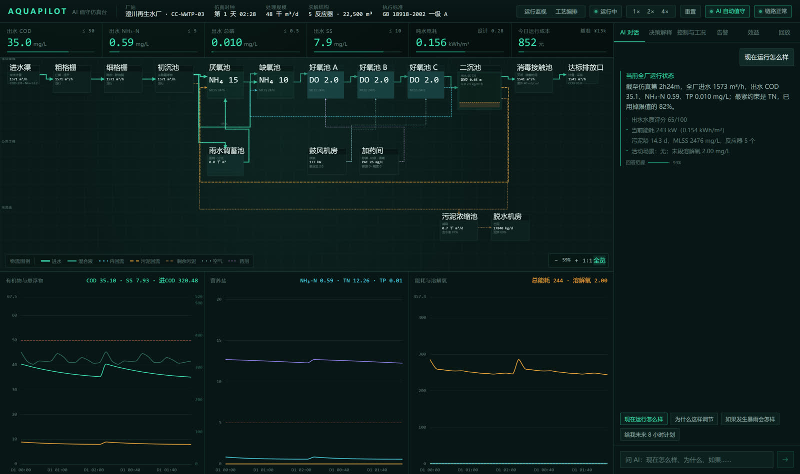
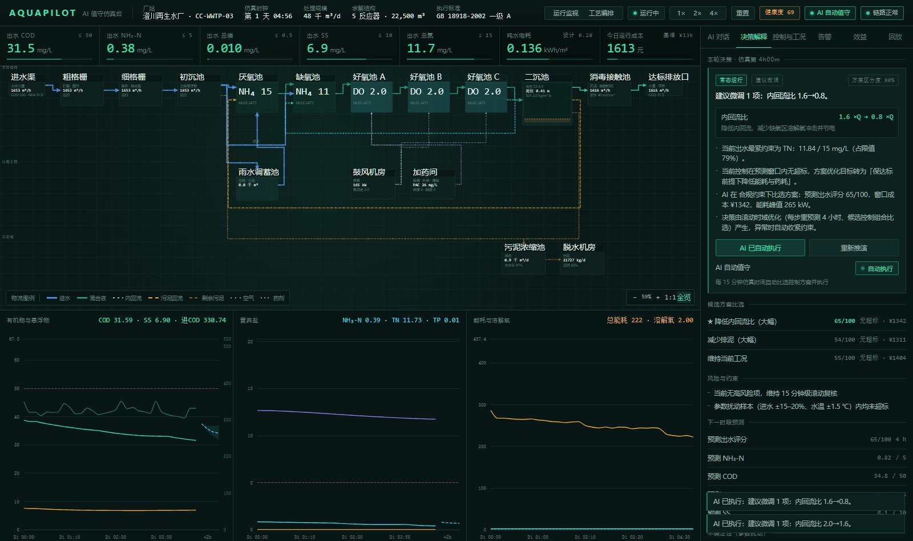
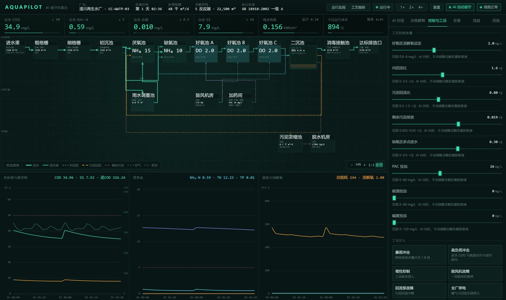
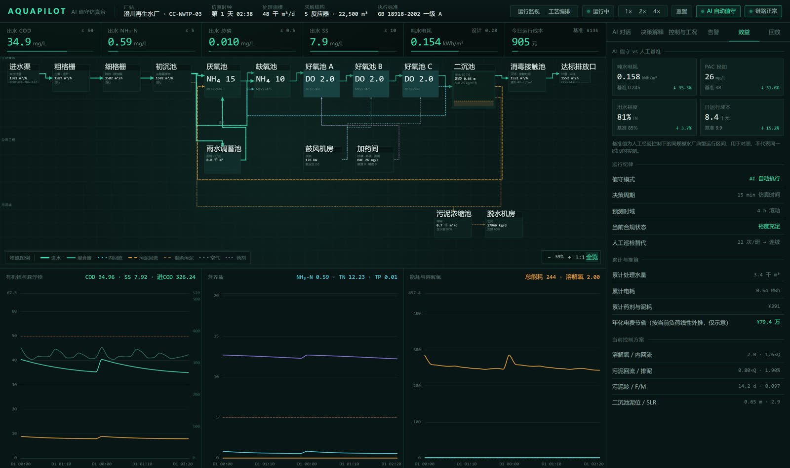
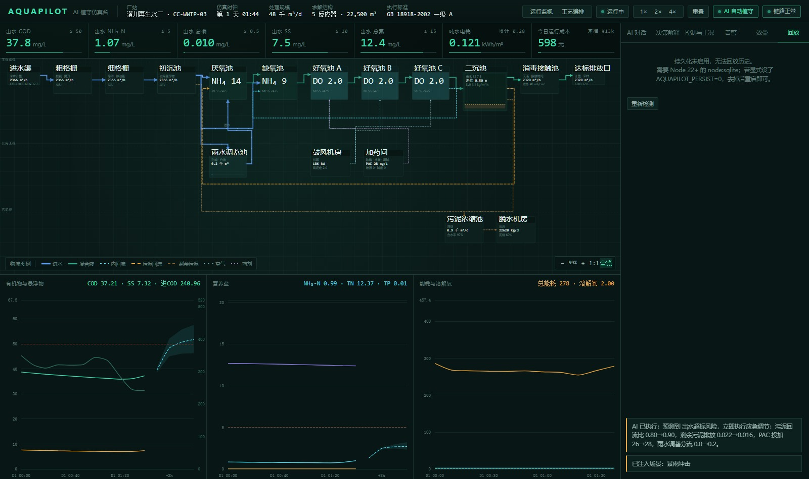
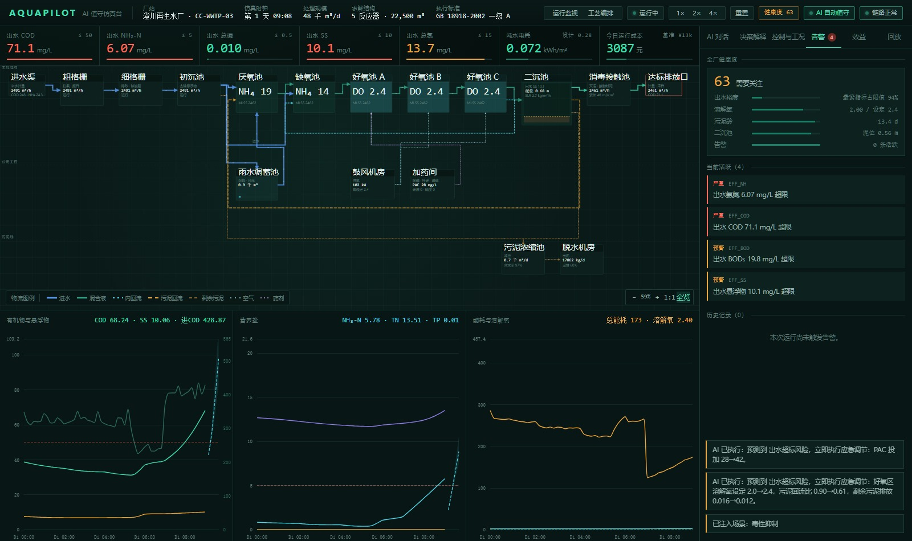
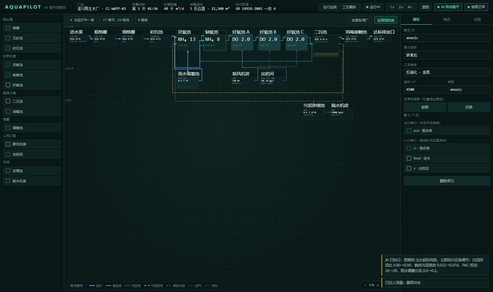
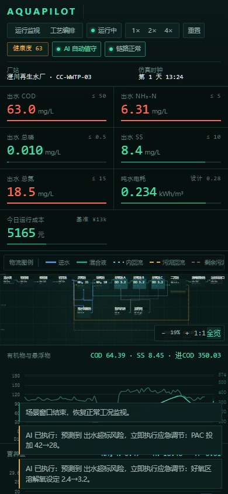

# AquaPilot

[English](README.md) · **中文**

> AI 值守的再生水厂仿真台。  
> 厂是图，图就是模型，AI 值班员来跑。

[](tests)
[](vitest.config.ts)
[](tsconfig.json)
[](LICENSE)



一个把工业仿真平台与 AI 操作员合成一体的可运行产品原型：工艺拓扑是唯一真相源，
引擎按拓扑真实求解水质演化，AI 值班员每 15 分钟做一次滚动预测、比选控制方案并在
硬护栏内执行，人只负责提问和划边界。

## 它解决什么

传统仿真平台（GPS-X、BioWin、WEST）能力强，但要求操作者自己设参数、看曲线、做判断。
这个项目换一种分工：**AI 看盘、AI 操作、人提问**。同时保留工程上真正重要的部分——
模型有出处、决策可复核、边界说得准。

| 传统仿真器 | AquaPilot |
|---|---|
| 工程师搭流程 | 工程师画厂，求解器编译 |
| 工程师读曲线 | AI 用数字解释每次决策 |
| 工程师调设定值 | AI 提议、硬护栏约束、人可随时接管 |
| 离线设计研究 | 在线运行 + 工况注入 + 回放 |
| 单点预测 | 固定扰动集合，输出 P10–P90 |

## 核心能力

- **拓扑驱动求解**：改图后引擎重新编译、拓扑排序并求解。加一个池子就真的多解一个池子。
- **真实工艺模型**：ASM1（13 组分 / 8 过程）+ Takács 十层二沉池；BSM1 开环 Table 6
  稳态对照写进 CI（`tests/bsm1-benchmark.test.ts`）。
- **AI 值守与硬护栏**：每 15 分钟仿真时间做 4 小时滚动预测，在约 20 个候选控制方案中比选，
  排序后再执行；DO 下限、PAC 底线、SRT 区间等是执行前就应用的硬约束。
- **鲁棒决策**：对入围候选追加固定参数扰动集合（进水 ±15%、COD/氨氮 ±20%、总磷 ±15%、
  水温 ±1.5 ℃、生物量 ±10%），把超限概率与最差样本折进排序，随建议一起给出 P10/P50/P90 区间。
- **同进水双跑**：影子厂与主厂共享 seed、进水序列和初值，只改控制策略。效益面板实时对比
  合规率、吨水电耗、吨水成本与平均出水评分。
- **可解释**：每条建议带预测出水、候选排名、逐项调节理由与方案区分度（明确标注为非概率）。
- **工况注入**：暴雨、冲击负荷、毒性抑制、鼓风机故障、回流泵故障、停电、低温、药剂短缺。
- **运营面**：Prometheus 指标、JSON 结构化日志、深健康检查、备份恢复、回放、CSV 导出与
  一页式 Markdown 值班报告。
- **告警归因与全厂健康度**：每条活跃告警都带工艺环节、原因、可执行动作与趋势外推后果；
  顶栏与告警面板展示五维加权健康度（出水裕度、溶解氧、污泥龄、二沉池、告警）。

## 演示


_30 秒走查：实时工艺图、AI 对话、决策解释、控制与工况、效益对比、回放、工艺编排。_

[MP4 版本](docs/media/demo.mp4) · [全部截图](docs/screenshots)

| 运行监视 | AI 对话 |
|---|---|
|  |  |

| 决策解释 | 控制与工况 |
|---|---|
|  |  |

| 效益对比 | 历史回放 |
|---|---|
|  |  |

| 告警归因与健康度 | 工艺编排 | 移动端 |
|---|---|---|
|  |  |  |

## 快速开始

```bash
npm ci
npm run build      # 类型检查 + 前端构建 + 服务端打包
npm start          # http://127.0.0.1:5173
```

开发模式（前端热更新 + 服务端自动重启）：

```bash
npm run dev        # 前端 5174，服务端 5173
```

验证：

```bash
npm run typecheck  # TypeScript 严格模式
npm run lint       # ESLint 9
npm run test       # 381 项测试
npm run build      # 客户端 + 服务端
npm run verify     # 上述四项按顺序跑
npm run ci         # 完整门禁：依赖、类型、测试、构建、冒烟、审计、卫生
npm run e2e        # Playwright 浏览器冒烟
```

Docker（已发布镜像，`linux/amd64`）：

```bash
docker run --rm -p 5173:5173 -v aquapilot-data:/app/data ghcr.io/morningstar202604/aquapilot:v0.3.0
```

或本地构建：

```bash
docker build -t aquapilot:local .
docker run --rm -p 5173:5173 -v aquapilot-data:/app/data aquapilot:local
```

可选配置全部走环境变量（见 [.env.example](.env.example)）：

```bash
AQUAPILOT_TOKEN=...            # /api/* 与 WebSocket 握手需要 Bearer 令牌
AQUAPILOT_LLM_BASE_URL=...     # 任何 OpenAI 兼容端点（DeepSeek / GLM / Qwen / Ollama / vLLM）
AQUAPILOT_LLM_MODEL=...
AQUAPILOT_LLM_API_KEY=...
```

## 架构

```
src/
  model/          工艺拓扑（唯一真相源）
    topology.ts     单元、端口、物流、拓扑校验、可运行性推导
    layout.ts       自动布局（主线分层 + 公用工程 + 污泥线 + 回流绕行）
    presets.ts      由标准厂派生的可运行工艺模板
  sim/            仿真引擎（纯函数、无 IO、可确定性复现）
    kinetics.ts     动力学常数与费率的唯一出处
    alarmAttribution.ts 告警归因（原因/动作/后果）与健康度评分
    network.ts      拓扑 → 编译网络、拓扑排序、流量求解
    networkEngine.ts 生产引擎：按拓扑驱动的 N 个反应器
    engine.ts       参考引擎：固定五池，用于标定与回归对照
    asm1.ts         ASM1：13 组分 / 8 过程，化学计量由参数推导
    asm1Cstr.ts     单池 CSTR 求解器
    takacs.ts       Takács 十层二沉池
    ensemble.ts     固定扰动集合预测与 P10/P50/P90
    metrics.ts      共享纯函数（评分、裕度、夹紧）
  ai/
    agent.ts        滚动时域决策、候选比选、护栏、问答
    llm.ts          可选 LLM 对话（OpenAI 兼容 + 数字白名单校验）
  server/
    benchmark.ts    影子双跑：AI vs 固定策略，同一进水
    export.ts       CSV / Markdown 报告
    trendCursor.ts  增量趋势游标（环形缓冲安全）
    index.ts        WebSocket 仿真循环、REST、静态托管
  client/           控制室界面（React + ECharts + SVG 工艺图）
  shared/           前后端消息契约
tests/              381 项测试：物理性质、守恒、AI 护栏、拓扑、双跑、输入校验、崩溃边界
```

### 三层契约

```
topology  →  layout  →  render
    ↘
     solve
```

渲染层不持有工艺知识，只画求解器给出的状态。这条约束防的是"图好看、数不对"。

### 趋势游标的由来

界面收的是增量补丁而不是全量快照（240 KB → 约 2 KB/帧）。第一版用"已收到的点数量"
当游标：720 点环形缓冲写满后，切片永远为空，所有客户端的曲线在后台静止。
现在游标是时间戳（`src/server/trendCursor.ts`），并有滚动缓冲的回归测试。

## 可复现的实测结论

### BSM1 Table 6 开环稳态对照

`npx vitest run tests/bsm1-benchmark.test.ts`：

| 指标 | 本引擎 | 官方 Table 6 | 偏差 | 门槛 |
|---|---:|---:|---:|---|
| S_S | 0.866 | 0.889 | −2.6% | ±10% |
| S_NO | 11.18 | 10.415 | +7.4% | ±10% |
| S_NH | 1.393 | 1.733 | −19.6% | ±25%（沉降器已知限制） |
| S_ALK | 4.05 | 4.13 | −2.0% | ±10% |
| S_O | 0.53 | 0.491 | +7.6% | ±10% |

S_NH 绝对差 0.34 gN/m³，不足氮通量的 1%，与二沉池 TSS 偏低同源。

### AI vs 固定策略（同一进水）

`npx tsx scripts/prove-benchmark.ts`：2 个仿真日、seed 20261019、96 个决策周期。

| 指标 | AI 值守 | 固定策略 | 差值 |
|---|---:|---:|---:|
| 出水合规率 | 92.3% | 56.7% | +35.6 个百分点 |
| 吨水电耗 | 0.150 kWh/m³ | 0.159 kWh/m³ | −5.6% |
| 吨水成本 | ¥0.1420 | ¥0.1963 | −27.7% |
| 平均出水评分 | 57.8 | 46.4 | +11.3 |

固定策略是可辩护的保守运行点（DO 2.0、内回流 2.0×Q、RAS 0.8×Q、排泥 2.2%、
PAC 40 mg/L、多点进水 0.3×Q），两条链都从同样的 30 天预热开始。

### 改图真的改变物理

`npx tsx scripts/prove-network-solving.ts`、`scripts/prove-topology-matters.ts`：

| 改动 | 结果 |
|---|---|
| 增加一个缺氧池 | 5 → 6 反应器，TN 9.74 → 9.15 mg/L |
| 增加两个好氧池 | 7 反应器，NH₄ 0.03 mg/L |
| 只保留一个好氧池 | 3 反应器，NH₄ 7.01 mg/L（超标） |
| 好氧池容积 ×2 / ÷2 | NH₄ 0.074 → 0.034 / 1.149 mg/L |
| 二沉池面积 ×2 | 泥位 1.15 → 0.66 m |

### 工程指标

| 项目 | 实测 | 命令 |
|---|---|---|
| 单步仿真（1 min） | 0.003 ms | `npx tsx scripts/bench.ts` |
| 单次 4 h 预测 | 1.4 ms | 同上 |
| 生产引擎决策（名义） | 153 ms | 同上 |
| 生产引擎决策（鲁棒，3 候选 × 3 样本） | 215 ms | 同上 |
| 30 天预热 | 约 110 ms | 同上 |
| 测试 | 381 通过 | `npm test` |
| 覆盖率 | 95.6% 行 / 84.7% 分支 | `npx vitest run --coverage` |

## AI 怎么决策

1. **预测**：从当前状态跑一次 4 小时基线预测。
2. **生成候选**：每个控制量两档升降 + 节能组合 + 达标优先组合，约 20 个。
3. **打分**：超标重罚 > 裕度不足中等罚 > 成本与频繁调整轻罚，再叠加 SRT 与工艺护栏惩罚。
4. **鲁棒复核**：对前 3 名 + 维持现状做固定扰动集合预测，按超限概率与最差样本扣分；
   最终只在被评估过的候选里选——不能让"没被评估"变成优势。
5. **解释**：给出动作、逐项理由、候选排名、预测出水、风险与区分度；区间与超限概率随建议返回。

护栏在执行前应用：DO 下限、PAC 底线、RAS 下限、排泥窗口、SRT 区间，并按场景收紧。

## 与同类项目的定位

详见 [docs/COMPARISON.md](docs/COMPARISON.md)（2026-10-24 查询）。

| 项目 | Star | 许可 | 模型深度 | 实时界面 | AI 操作 | 拓扑编辑 |
|---|---:|---|---|---|---|---|
| **AquaPilot** | — | MIT | ASM1 + Takács + BSM1 门禁 | 有 | 有 | 有 |
| [fau-evt/bsm2-python](https://github.com/fau-evt/bsm2-python) | 44 | BSD-3 | BSM1/BSM2、ADM1 | 无 | 无 | 无 |
| [toogad/PooPyLab_Project](https://github.com/toogad/PooPyLab_Project) | 79 | GPL-3.0 | ASM 系列、稳态 | 无 | 无 | 图示文件 |
| [modelica-3rdparty/WasteWater](https://github.com/modelica-3rdparty/WasteWater) | 75 | — | Modelica 库 | 无 | 无 | Modelica |
| [endearqb/AutoWaterSimu](https://github.com/endearqb/AutoWaterSimu) | 15 | NOASSERTION | ASM1/ASM3/UDM | 有 | 部分 | 有 |
| [USEPA/Stormwater-Management-Model](https://github.com/USEPA/Stormwater-Management-Model) | 376 | — | 水文水力 | 桌面 | 无 | 网络编辑 |

AquaPilot 不替代设计级仿真器。它要成为的是"AI 操作员 + 真实求解器 + 可审计工艺图"
这套组合的最佳开源示范，并且用 BSM1 门禁把模型可信度钉住。

## 已知边界

这是**仿真原型**，不是可接管真实水厂的系统：

- 二沉池十层模型在浓缩区梯度不足，回流浓度低于实际；出水 TSS 低于 BSM1 参考值。
- ASM1 不含磷，总磷依赖化学沉淀。
- BSM1 的 S_NH 偏差 −19.6%（0.34 gN/m³，不足氮通量 1%），以 ±25% 锁定；
  彻底收敛需要重写二沉池数值格式。
- 单用户；仿真状态在内存，历史写入 SQLite（Node 22+）供回放与导出。
- 访问控制是单一共享令牌，不是多用户权限；生产部署需 TLS 与反向代理。

## 文档

- [HTTP API 与 WebSocket 协议](docs/API.md)
- [界面架构](docs/UI-ARCHITECTURE.md)
- [基准与实测](docs/BENCHMARKS.md)
- [同类项目对比](docs/COMPARISON.md)
- [部署](docs/DEPLOYMENT.md)
- [质量路线](docs/QUALITY-ROADMAP.md)
- [SLO](docs/SLO.md)
- [审计报告](docs/AUDIT-REPORT.md)
- [脚本说明](scripts/README.md)

## 许可证

MIT
