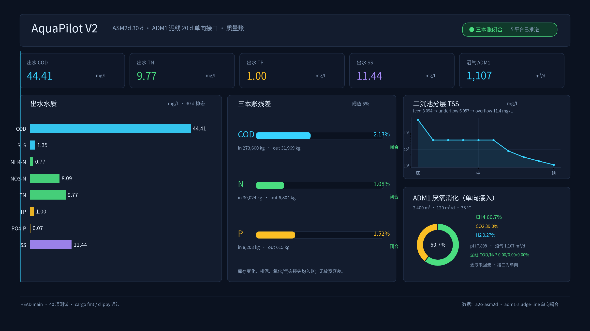

# AquaPilot v2 基准记录

> 记录日期：2026-11-28
> 代码：`rust-v2/`，版本 0.0.7
> 口径：clean-room 实现；不读取旧 `src/sim` 或旧 `rust/` 源码。

## 1. V2-1 BSM1-like 整厂

fixture：`rust-v2/fixtures/bsm1-like.json`

| 项目 | 值 |
| --- | --- |
| 进水流量 | 1000 m3/h |
| 反应器 | 2 缺氧 + 3 好氧，总池容 7000 m3 |
| 二沉池 | 面积 5500 m2，深度 4 m，10 层，feed layer 5 |
| RAS | 1000 m3/h |
| 内回流 | 1500 m3/h |
| WAS | 30 m3/h |
| 出水 | 970 m3/h |
| 步长 | 1 min |
| 时长 | 30 d / 43,200 步 |

### 1.1 出水

| 指标 | 实测 |
| --- | --- |
| COD | 58.01 mg/L |
| S_S | 0.684 mg/L |
| SS | 12.20 mg/L |
| NH4-N | 0.292 mg/L |
| NO3-N | 1.269 mg/L |
| TN | 18.165 mg/L |
| TP | 0.000 mg/L（ASM1 不建模 TP） |
| DO | 2.000 mg/L |
| 碱度 | 110.56 mg/L as CaCO3（约 2.211 mol/m3） |

### 1.2 反应器

| 单元 | MLSS mg/L | COD mg/L | NH4-N mg/L | NO3-N mg/L | DO mg/L |
| --- | --- | --- | --- | --- | --- |
| 缺氧池 1 | 2711.8 | 3984.7 | 9.206 | 0.07 | 0.03 |
| 缺氧池 2 | 2712.3 | 3984.7 | 9.739 | 0.00 | 0.00 |
| 好氧池 1 | 2745.4 | 3961.8 | 3.810 | 0.28 | 2.00 |
| 好氧池 2 | 2754.7 | 3955.1 | 1.167 | 0.88 | 2.00 |
| 好氧池 3 | 2755.8 | 3953.9 | 0.292 | 1.27 | 2.00 |

### 1.3 二沉池

| 指标 | 实测 |
| --- | --- |
| feed TSS | 2755.8 mg/L |
| underflow TSS | 5341.9 mg/L |
| overflow TSS | 12.2 mg/L |
| RAS / WAS | 1000 / 30 m3/h |
| 层 TSS（底→顶） | 5341.9, 350.6, 350.6, 350.6, 350.6, 350.6, 80.1, 35.3, 20.5, 12.2 mg/L |

### 1.4 COD 账（30 d，kg）

| 行 | 值 |
| --- | --- |
| 进水 | 288,000.0 |
| 出水 | 40,782.2 |
| 排泥 | 207,713.7 |
| 库存变化 | −49,767.3 |
| 未解释项 | 89,271.4 |

未解释项包含氧化，**本阶段不声称 COD 闭合**。三本账与氧化项属于 V2-2。

## 2. 官方 BSM1 几何

fixture：`rust-v2/fixtures/bsm1-official.json`

采用 BSM1 公开几何与稳定进水组分：

- 反应器：1000 / 1000 / 1333 / 1333 / 1333 m3；
- 二沉池：1500 m2、4 m、10 层、feed layer 6；
- 流量：Q0 18,446 m3/d、RAS 18,446、内回流 55,338、WAS 385；
- 进水：S_I 30、S_S 69.5、X_I 51.2、X_S 202.32、X_BH 28.17、S_NH 31.56、S_ND 6.95、X_ND 10.59、S_ALK 350 mg/L as CaCO3；
- 15 ℃；前两池缺氧，后三池 KLa 10 / 10 / 3.5 h-1；
- 各反应器初值取自 BSM1 Table 6 稳态组分。

### 2.1 clean-room ASM1 修正

首轮对照 Table 6 暴露了 7 处实现问题，已全部修正：

1. `X_P` 与 `X_S` 的衰减产物系数写反；
2. 硝化只消耗 NH4-N，没有生成 NO3-N；
3. `X_ND` 水解与 `S_ND` 释放缺失；
4. 生物同化与反硝化的碱度系数按 7.14 计，实际应为 3.57 mg CaCO3/mg N；
5. 衰减没有把生物体氮转入 `X_ND`；
6. 水解没有按电子受体限制（好氧 / 缺氧 / 厌氧）；
7. 硝化产 NO3 时没有扣除进入 `X_BA` 的生物体氮。

对应新增回归测试：硝化产 NO3、`X_ND` 水解释放 `S_ND`、衰减产物分配。

### 2.2 官方参数集 30 天结果

参数：`Asm1Params::bsm1_15c()`（公开 15 ℃ 集，`eta_g=0.8`、`eta_h=0.8`），KLa 10 / 10 / 3.5。

| 指标 | V2（官方参数集） | BSM1 Table 6 | 偏差 |
| --- | --- | --- | --- |
| 出水 COD | 47.84 mg/L | 约 47.65 mg/L | 接近 |
| 出水 S_S | 0.863 mg/L | 0.889 mg/L | −2.9% |
| 出水 SS | 11.95 mg/L | 12.50 mg/L | −4.4% |
| 出水 NH4-N | 0.807 mg/L | 1.733 mg/L | −53.4% |
| 出水 NO3-N | 11.276 mg/L | 10.415 mg/L | +8.3% |
| 出水 DO | 1.143 mg/L | 0.491 mg/L | +132.8% |
| 出水碱度 | 4.05 mol/m3 | 4.13 mol/m3 | −1.9% |
| 反应器 MLSS | 3103–3117 mg/L | 约 3070 mg/L | +1.1–1.5% |
| 二沉池 underflow TSS | 6,068 mg/L | 6,394 mg/L | −5.1% |

结论：**S_S、SS、NO3、碱度、MLSS、underflow 已进入 Table 6 量级；NH4 偏低、DO 偏高，官方参数集没有全部通过 Table 6。** 剩余偏差集中在氧传递与硝化/反硝化分配，不是几何或进水口径。

### 2.3 校准候选

新增 `fixtures/bsm1-calibrated.json`：几何、进水、初值与官方 fixture 相同，只把有效 KLa 调为 8.9 / 8.9 / 2.95 h-1；参数用 `Asm1Params::bsm1_calibrated()`，在公开 15 ℃ 集上只把缺氧水解修正 `eta_h` 从 0.8 调到 0.6。

| 指标 | V2（校准候选） | BSM1 Table 6 | 偏差 |
| --- | --- | --- | --- |
| 出水 COD | 47.91 mg/L | 约 47.65 mg/L | 接近 |
| 出水 S_S | 0.934 mg/L | 0.889 mg/L | +5.1% |
| 出水 SS | 11.95 mg/L | 12.50 mg/L | −4.4% |
| 出水 NH4-N | 1.513 mg/L | 1.733 mg/L | −12.7% |
| 出水 NO3-N | 9.983 mg/L | 10.415 mg/L | −4.1% |
| 出水 DO | 0.466 mg/L | 0.491 mg/L | −5.1% |
| 出水碱度 | 4.19 mol/m3 | 4.13 mol/m3 | +1.5% |
| 反应器 MLSS | 3103–3118 mg/L | 约 3070 mg/L | +1.1–1.6% |
| 二沉池 underflow TSS | 6,067 mg/L | 6,394 mg/L | −5.1% |

反应器剖面（实测 / Table 6）：

| 单元 | S_S | S_NO | S_NH | S_O |
| --- | --- | --- | --- | --- |
| 缺氧池 1 | 2.497 / 2.81 | 5.36 / 5.37 | 7.65 / 7.92 | 0.018 / 0.0043 |
| 缺氧池 2 | 1.205 / 1.46 | 3.92 / 3.66 | 7.97 / 8.34 | 0.000 / 0.0000631 |
| 好氧池 1 | 1.244 / 1.15 | 6.61 / 6.54 | 5.13 / 5.55 | 1.932 / 1.72 |
| 好氧池 2 | 1.095 / 0.995 | 9.12 / 9.30 | 2.63 / 2.97 | 2.715 / 2.43 |
| 好氧池 3 | 0.934 / 0.889 | 9.98 / 10.4 | 1.51 / 1.73 | 0.466 / 0.491 |

校准候选的全部关键指标落在 Table 6 的 **±20% 工程容差**内；`bsm1_calibrated_plant_matches_table6_within_twenty_percent` 测试锁定该门禁。`eta_h=0.6` 与有效 KLa 是**校准候选，不是公开 BSM1 参数集**，不能用于声称“官方参数复原”。

## 3. V2-2 ASM2d A2O 整厂



fixture：`rust-v2/fixtures/a2o-asm2d.json`，CLI：`aquapilot-v2 asm2d`。

| 项目 | 值 |
| --- | --- |
| 反应器 | 厌氧 4000 + 缺氧 4000 + 好氧 2000/2000/2000 m3 |
| 二沉池 | 面积 6000 m2，深度 4 m，10 层，feed layer 5 |
| 进水流量 | 1000 m3/h |
| RAS / 内回流 / WAS | 1000 / 2000 / 20 m3/h |
| 好氧 KLa | 8.0 h-1，DO 设定 2.0 mg/L |
| 步长 / 时长 | 1 min，30 d / 43,200 步 |

| 指标 | 实测 |
| --- | --- |
| 出水 COD | 44.41 mg/L |
| 出水 S_S | 1.347 mg/L |
| 出水 NH4-N | 0.771 mg/L |
| 出水 NO3-N | 8.094 mg/L |
| 出水 TN | 9.767 mg/L |
| 出水 TP | 1.004 mg/L |
| 出水 PO4-P | 0.068 mg/L |
| 出水 SS | 11.44 mg/L |
| 出水 DO | 2.000 mg/L |
| 二沉池 feed / underflow / overflow TSS | 3093.95 / 6056.61 / 11.44 mg/L |
| COD 账残差 | 2.13%（closed） |
| N 账残差 | 1.09%（closed） |
| P 账残差 | 1.52%（closed） |

2026-11-27 修正：`Asm2dState::total_cod` 补入 `X_AUT`（硝化菌生物量 COD）。此前漏计使出水 COD 显示 44.17、COD 账残差 1.98%；补入后分别为 44.41 与 2.13%，N/P 账不变。2×500 m3/h 汇总同步为 44.41 / 2.13%。

ASM2d 实现覆盖 19 组分（18 个独立动力学状态 + 由颗粒组分导出的 `X_TSS`）与 21 个过程：好氧/缺氧/厌氧水解，`S_F`/`S_A` 异养生长与反硝化，发酵，异养溶菌，PAO 的 PHA 储存、好氧/缺氧 PP 储存、好氧/缺氧生长、PAO/PP/PHA 溶菌，自养好氧生长与溶菌，化学沉淀与再溶解。化学计量矩阵与速率方程来自公开 ASM2d 资料；`X_TSS` 不作为独立动力学状态，避免与 COD 组分重复计量。

当前边界：

- COD 账已将异养/PAO 氧耗与反硝化 COD 计入氧化行，残差 2.13%；
- N 账按 `rates.sn2` 记气态氮，残差 1.09%；
- P 账在修正 `X_S` 的 N 计量、引入二沉池颗粒组分池与正性保持子步后，残差 1.52%；
- 三本账在单系列 A2O fixture 上均 `closed=true`；这是 A2O 内部账，不含泥线回流。ADM1 泥线与回流闭环见 5.1/5.2，PAC 见 5.3；本 fixture 未投 PAC，不能当作完整 V2-2 验收。

### 3.1 多系列二沉池

`fixtures/a2o-asm2d-2train.json` 把单系列按 1/2 缩放为两个并行系列：各 500 m3/h、反应器 2000/2000/1000/1000/1000 m3、二沉池 3000 m2、RAS 500、内回流 1000、WAS 10 m3/h。每个系列独立拥有二沉池与 RAS/WAS，汇总器按流量加权出水并求和三本账。

| 指标 | 2×500 m3/h 汇总 |
| --- | --- |
| 总进水 / 出水 / 排泥 | 1000 / 980 / 20 m3/h |
| 出水 COD | 44.41 mg/L |
| 出水 NH4-N | 0.771 mg/L |
| 出水 TN | 9.767 mg/L |
| 出水 TP | 1.004 mg/L |
| 出水 SS | 11.44 mg/L |
| COD / N / P 残差 | 2.13% / 1.08% / 1.52%，均 closed |

两系列结果与单系列一致；这是因为几何、流量、负荷与 SRT 均按比例缩放。该 fixture 验证的是多系列编排、汇总与逐系列质量账，而不是不同系列负荷分配下的偏差。

## 4. ADM1 核心 CSTR

fixture：`rust-v2/fixtures/adm1-tutorial.json`，CLI：`aquapilot-v2 adm1`。

| 项目 | 值 |
| --- | --- |
| 反应器 | 850 m3 CSTR |
| 进料 / 温度 / 气相比 | 170 m3/d / 308.15 K / 0.1 |
| 状态 | 24 个动力学组分 + 2 个强离子（`S_cat`、`S_an`），共 26 |
| 过程 | 22 个 ADM1 过程 |
| 数值 | 显式欧拉，dt 0.002 d，10 d / 29,253 步 |

| 指标 | 实测 |
| --- | --- |
| pH | 6.948 |
| 出水 COD | 38.92 kg COD/m3 |
| 出水 N | 3.532 kg N/m3 |
| 出水 SS | 16.85 kg/m3 |
| 乙酸 | 8.57 kg COD/m3 |
| 沼气 | 1,657.7 m3/d |
| CH4 | 825.0 m3/d（49.77%） |
| CO2 / H2 | 49.41% / 0.825% |
| COD 账 | in 96,961.2 / out 57,890.1 / gas 23,654.2 / inventory 15,422.7 kg，残差 -0.006% |
| N 账 | in 6,250.0 / out 5,466.7 / inventory 783.7 kg，残差 -0.005% |

实现要点：强离子电荷平衡 + 二分求 `H+`，Ka 做 van’t Hoff 温度修正；H2/NH3/IN 抑制按 ADM1 形式；气相用准稳态 headspace，以有符号净转移累计气量；CSTR 瞬态出流逐步累计，不用 `final_conc * Q * days`。默认矩阵直接取 QSDsan 1.5.3 的 ADM1 默认解析矩阵，行级 COD/N 守恒有单测。

已知偏差：

- 乙酸 8.57 kg COD/m3，比 QSDsan 教程约 5.32 高约 61%；测试容差放到 3–10，不能声称与 QSDsan 完全一致。
- Henry 常数保留 `kh_h2=0.001`、`kh_ch4=0.001`、`kh_co2=0.035`（kg/m3/bar 直接值），与 QSDsan 的 `KHb/unit_conversion` 口径存在已知近似；这是当前 pH/账稳定的工程选择。
- 仅核心 CSTR，不含浓缩、脱水、滤液回流，也不含 ASM2d 组分翻译。

## 5. 独立泥线（浓缩 + 消化 + 脱水）

fixture：`rust-v2/fixtures/adm1-sludge-line.json`，CLI：`aquapilot-v2 sludge-line`。

| 项目 | 值 |
| --- | --- |
| 进泥 | 480 m3/d，COD 6.79 kg/m3，N 0.325，P 0.489 kg/m3 |
| 浓缩 | 底流 120 m3/d，颗粒捕获 90%，P 颗粒占比 90% |
| 消化 | 2,400 m3，HRT 20 d，308.15 K |
| 脱水 | 泥饼 250 kg/m3 TS，颗粒捕获 95% |
| 步长 / 时长 | 0.002 d，20 d |

| 指标 | 实测 |
| --- | --- |
| 浓缩底流 | COD 24.73 kg/m3，N 1.132，P 1.633 kg/m3 |
| 消化 pH | 7.977 |
| 沼气 | 1,211.3 m3/d，CH4 62.2% |
| 泥饼 | 2.65 m3/d，250 kg/m3 TS，P 63.45 kg/m3 |
| 滤液 | 117.35 m3/d，P 0.238 kg/m3 |
| COD 账 | in 67,872.1 / overflow 8,784.1 / cake 20,484.4 / filtrate 2,869.0 / gas 43,092.4 / inventory -7,894.5 kg，残差 0.00% |
| N 账 | in 3,121.5 / overflow 405.5 / cake 1,348.5 / filtrate 1,438.6 / inventory -122.1 kg，残差 0.00% |
| P 账 | in 4,694.4 / overflow 774.6 / cake 3,360.1 / filtrate 559.7 kg，残差 0.00% |

边界：本节进泥是代表 A2O 排泥的合成流；实际排泥接入见 5.1。ADM1 不含 P，P 只作惰性示踪，不能称为 ADM1-P；泥饼 TS 是给定边界，不是由过滤动力学预测。

### 5.1 A2O 排泥接入（单向）

CLI：`aquapilot-v2 asm2d-sludge`。先跑 30 d A2O，取二沉池 WAS 底流（20 m3/h，COD 6,947.3、TN 306.83、TP 488.69 mg/L），按 COD/N/P 守恒翻译成 ADM1 进料：

| 项目 | 值 |
| --- | --- |
| ADM1 进料 | 480 m3/d，COD 6.947、N 0.307、P 0.489 kg/m3 |
| 消化器 | 2,400 m3，120 m3/d，35 °C，20 d |
| 消化 pH | 7.898 |
| 沼气 / CH4 / CO2 / H2 | 1,106.5 m3/d / 60.7% / 39.0% / 0.27% |
| 泥饼 | 2.78 m3/d，250 kg/m3 TS，P 60.38 kg/m3 |
| 滤液 | 117.22 m3/d，P 0.238 kg/m3 |
| 泥线 COD / N / P 残差 | 0.00% / 0.00% / 0.00%，均 closed |

接口边界：ASM2d 的 18 个状态中，颗粒 COD 统一映射为 ADM1 `X_c`，硝酸盐氮并入 `S_IN`，ASM2d 总磷进入惰性 P 示踪；边界三本账守恒有单测。`asm2d-sludge` 仍是单向接口：滤液只报告、不回流；回流闭环见 5.2。泥线 COD/N 账使用 ADM1 时间积分出水；泥饼/滤液质量是末态分流，用于运行报表，不在 COD/N 残差中重复计入。

### 5.2 泥线回流闭环（浓缩溢流 + 滤液）

CLI：`aquapilot-v2 asm2d-loop`。把重力浓缩溢流（360 m3/d，15 m3/h）与脱水滤液（117.22 m3/d，4.884 m3/h）按流量加权合并为 477.22 m3/d（19.884 m3/h），翻回 ASM2d 状态后接回 A2O 进水；successive substitution，`relaxation=1.0`、`max_iterations=6`、`tolerance=1e-3`，30 d 下 4 次迭代收敛。

| 项目 | 值 |
| --- | --- |
| 回流流量 | 19.884 m3/h |
| 回流 COD / N / P | 1,366.3 / 202.709 / 160.359 mg/L |
| A2O 出水 COD / NH4-N / TN / TP / SS | 53.61 / 0.605 / 10.587 / 3.872 / 11.69 mg/L |
| A2O 出水流量 | 999.9 m3/h |
| 消化 pH / 沼气 / CH4 | 7.884 / 1,093.6 m3/d / 60.4% |
| 泥饼 / 滤液 | 2.78 m3/d / 117.22 m3/d |
| 整厂 COD 账 | in 273,600.0；eff 39,050.8；cake 36,668.9；gas 231,164.9；inventory -30,454.3 kg；残差 -1.03%，closed |
| 整厂 N 账 | in 30,024.0；eff 7,551.2；cake 2,232.3；gas 21,970.2；inventory -2,387.8 kg；残差 2.19%，closed |
| 整厂 P 账 | in 8,208.0；eff 1,249.6；cake 5,117.6；inventory 1,782.5 kg；残差 0.71%，closed |

口径：整厂账用 A2O 的**时间积分**出水/排泥，不用末态浓度乘全周期；泥饼取 `A2O 积分排泥 − 回流负荷 − 消化沼气`，不直接取泥线末态泥饼。前者避免把末态速率当整段平均，后者避免把回流 P 重复算成外部输出。P 账没有气相项，泥饼为 `A2O 积分排泥 P − 回流 P`。

60 d 稳态检查：回流 19.886 m3/h，A2O 出水 COD 53.41、TN 10.641、TP 3.555、SS 11.67 mg/L；整厂 COD / N / P 残差 -1.64% / 1.15% / 0.40%，均 closed。

边界：P 质量账已闭环，但回流把泥线 P 带回 A2O，出水 TP 3.872 mg/L（30 d）/ 3.555 mg/L（60 d），高于常见排放限值；这不是 P 去除达标。5.2 本身未投加 PAC，PAC 见 5.3。本节只证明“回流闭环 + 整厂三本账闭合”，不是完整 V2-2 验收。

### 5.3 PAC 投加与化学除磷

CLI：`aquapilot-v2 asm2d --pac-dose` / `asm2d-loop --pac-dose`，fixture `fixtures/a2o-asm2d-pac.json`。PAC 产品按 40 mg/L（以混合进水流量计）投入 `aerobic-3`；产品 Al2O3 品位 30%，Al 质量按 `54/102` 换算，再按 `107/27` 映射为 ASM2d `X_MeOH` 当量。化学沉淀沿用 ASM2d 默认 `3.45 g X_MeOH / g P`、`4.87 g X_MeP / g P` 系数。

不带泥线回流的单程 PAC 40 mg/L：

| 项目 | 值 |
| --- | --- |
| PAC 产品 / Al / X_MeOH 当量 | 960.0 / 152.5 / 604.2 kg/d |
| 净化学除磷 | 1,566.5 kg / 30 d |
| 出水 COD / NH4-N / TN / TP / PO4-P / SS | 42.72 / 0.717 / 9.665 / 1.116 / 0.301 / 11.58 mg/L |
| P 账 | in 8,208.0；eff 648.0；waste 6,461.8；inventory 979.3 kg；残差 1.45%，closed |

单程剂量扫描（30 d，不带回流，同一 A2O fixture）：

| PAC 产品 mg/L | 出水 TP | 出水 PO4-P | 净化学除磷 kg/30 d |
| --- | --- | --- | --- |
| 20 | 1.043 | 0.172 | 908.8 |
| 40 | 1.116 | 0.301 | 1,566.5 |
| 60 | 1.162 | 0.394 | 1,941.4 |
| 80 | 1.123 | 0.395 | 2,047.2 |
| 120 | 1.061 | 0.398 | 2,139.7 |
| 200 | 0.967 | 0.405 | 2,210.6 |
| 300 | 0.886 | 0.411 | 2,244.9 |

剂量从 20 加到 300 mg/L，净化学除磷增加约 1.3 t/30 d，但 TP 只从 1.043 降到 0.886，说明单靠 ASM2d 化学沉淀 + 现有二沉池存在平台；继续加药主要增加 `X_MeOH` 固体和污泥负荷，不能替代三级过滤或提高泥线 P 截留。

PAC + 泥线回流闭环 30 d：

| 项目 | 值 |
| --- | --- |
| 迭代 / 回流 | 6 次收敛，19.883 m3/h |
| 回流 COD / N / P | 1,377.5 / 203.843 / 172.945 mg/L |
| PAC 产品 / Al / X_MeOH 当量 | 979.1 / 155.5 / 616.2 kg/d |
| 净化学除磷 | 1,751.8 kg / 30 d |
| A2O 出水 COD / NH4-N / TN / TP / SS | 52.09 / 0.650 / 10.541 / 1.760 / 11.83 mg/L |
| 消化 pH / 沼气 / CH4 | 7.885 / 1,101.3 m3/d / 60.4% |
| 泥饼 / 滤液 | 2.80 m3/d / 117.20 m3/d |
| 整厂 COD / N / P 残差 | -1.11% / 2.14% / 1.31%，均 closed |

PAC 把回流闭环出水 TP 从 3.872 降到 1.760 mg/L（约 55%），P 账仍闭合；但 1.760 mg/L 仍高于常见排放限值，且模型没有区分 Al/Fe 形态、没有单独计入 PAC 水解的碱度消耗。PAC 之后的深度处理见 5.4。

### 5.4 三级过滤与 PO4 抛光

CLI：`aquapilot-v2 asm2d --tertiary-tss-removal` / `asm2d-loop --tertiary-tss-removal --tertiary-po4-removal`，fixture `fixtures/a2o-asm2d-pac-tertiary.json`。三级过滤在二沉池后按 `tss_removal_fraction` 捕集所有 ASM2d 颗粒组分，溶解态组分直接通过；可选的 `po4_removal_fraction` 把溶解 PO4 以经验抛光效率转入滤饼 P。捕集固体计入 `waste_kg`，P 账仍闭合。

单程 PAC 20 mg/L + 三级过滤（90% TSS、70% PO4 抛光）30 d：

| 项目 | 值 |
| --- | --- |
| 三级过滤 TSS | 11.51 → 1.15 mg/L |
| 捕集固体 / 捕集 P | 7,617.8 kg / 537.7 kg |
| 出水 COD / NH4-N / TN / TP / PO4-P / SS | 32.46 / 0.755 / 9.241 / 0.150 / 0.051 / 1.15 mg/L |
| P 账残差 | 1.49%，closed |

PAC 20 mg/L + 三级过滤回流闭环 30 d：

| 项目 | 值 |
| --- | --- |
| 迭代 / 回流 | 5 次收敛，19.884 m3/h |
| PAC 产品 / Al / X_MeOH 当量 | 489.5 / 77.8 / 308.1 kg/d |
| 净化学除磷 | 1,059.0 kg / 30 d |
| 三级过滤 TSS / PO4 抛光 | 11.77 → 1.18 mg/L；抛光去除 PO4 126.6 kg/30 d |
| 出水 COD / NH4-N / TN / TP / SS | 41.66 / 0.617 / 10.073 / 0.387 / 1.18 mg/L |
| 消化 pH / 沼气 / CH4 | 7.885 / 1,098 m3/d / 60.4% |
| 泥饼 / 滤液 | 2.79 m3/d / 117.21 m3/d |
| 整厂 COD / N / P 残差 | -1.07% / 2.16% / 1.29%，均 closed |

关键出水指标达到 GB 18918 一级 A 常见限值（COD 50、SS 10、NH4-N 5、TN 15、TP 0.5）；BOD、粪大肠菌群、色度等未建模，不能宣称全指标合规。三级过滤是理想化颗粒捕集 + 经验 PO4 抛光，不含反冲洗水力学、滤料级配和过滤压头，不能当作详细滤池设计。捕集固体与抛光 P 都计入 `waste_kg`，因此整厂 `cake_kg` 包含滤饼，不等于泥线脱水机的泥饼。

## 6. 质量门

```bash
cd rust-v2
cargo fmt --all --check
cargo clippy --workspace --all-targets -- -D warnings
cargo test --workspace
```

2026-11-28 结果：46 项测试全过（model 38 + engine 8），fmt/clippy 干净。ASM1 30 天测试在 debug 模式下约 0.3–0.4 s 完成；ASM2d A2O 30 天约 0.6 s，PAC 30 天约 0.6 s，PAC + 三级过滤 30 天约 0.7 s，2×500 m3/h 两系列约 1.2 s；ADM1 10 天约 1.4 s，独立泥线 20 天约 10.6 s，A2O 30 d + 泥线 20 d 单向耦合约 11 s；回流闭环 30 d 约 80 s，PAC + 三级过滤回流闭环 30 d 约 120 s。

## 7. 未做与边界

- 官方参数集仍未全部通过 Table 6；校准候选在 ±20% 内通过，但属于工程标定，不是官方参数复原。
- 没有真实管网水力求解；连接流量仍是显式给定。
- 没有 pH/碱度限制；碱度会被钳制到 0，当前只作诊断，不阻断。
- ASM2d 已落 A2O 整厂与多系列汇总；ADM1 核心、独立泥线、双向接口与回流闭环已落，整厂 COD/N/P 三本账在 30 d/60 d 均闭合；PAC 基础投加与三级过滤已落，PAC + 三级过滤回流闭环 30 d 出水 TP 0.387 mg/L，关键指标达到 GB 18918 一级 A 常见限值。
- PAC 使用三价金属当量与 ASM2d 默认 Fe(OH)3/FePO4 质量系数，未区分 Al/Fe 形态，未计入 PAC 水解碱度消耗。
- 三级过滤按固定 TSS 捕集率 + 经验 PO4 抛光效率计算，不含反冲洗水、滤料级配和过滤压头；BOD、粪大肠菌群、色度等未建模。
- 没有 24 h soak；V2-3 已有 HTTP + SSE 服务和首版可视化编排台，WebSocket 尚未实现。

## 6. V2-3 服务与实验（2026-11-28，版本 0.0.7）

### 6.1 服务测试

`aquapilot-service` 18 项单元测试 + 1 项 worker 集成测试全过；全 workspace 66 项（model 39 + engine 8 + service 18 + worker 1）：

- 7 项 SQLite store：创建/读取、幂等重放与冲突、队列满、queued 取消、一致备份、运行时崩溃恢复；
- 5 项 runner 校验：步数/采样预算、`sludge_dt_days` 正数、迭代/松弛上限、`sludge_days` 范围；
- 6 项 API 契约：创建/幂等/409 + 422、队列满 429 + `Retry-After: 30` + 取消、Content-Type、413、OpenAPI/健康检查、页面/预设（`GET /` 返回 HTML，`/api/v1/presets` 返回 6 个 preset）。

### 6.2 60 s soak smoke

命令：

```bash
python3 scripts/soak_v2.py --duration 60 --interval 2
```

结果：`docs/soak-smoke-summary.json`

| 指标 | 值 |
| --- | --- |
| 提交 / 成功入队 / 重放 / 队列满 | 30 / 30 / 0 / 0 |
| 请求失败 / 健康检查失败 | 0 / 0 |
| 最终状态 | 30 succeeded |
| 创建延迟 P50 / P95 / max | 2.807 / 3.359 / 3.733 ms |
| max RSS | 12,800 KB |
| max open fds | 13 |
| DB 文件（main + WAL + SHM） | 2,039,216 B |
| `completed_24h` | false |

这是 60 s smoke，不是 24 h 验收。24 h 命令为 `python3 scripts/soak_v2.py --duration 86400 --interval 30`；脚本只有在 `duration >= 86400` 且实际运行满 24 h 时才把 `completed_24h` 写成 true。

### 6.3 手动端到端

- ASM1 BSM1 24 h：202 入队，约 2 s 后 succeeded；出水 COD 48.52、SS 12.81 mg/L；CSV 25 行，报告含 COD 账。
- ASM2d A2O + PAC 20 + 三级过滤 30 d：succeeded；出水 COD 32.46、NH4-N 0.755、TN 9.241、TP 0.1496、SS 1.151、PO4-P 0.0515 mg/L；三级过滤捕集固体 7,617.8 kg、捕集 P 537.7 kg、PO4 抛光 45.2 kg/30 d。
- ASM2d/ADM1 回流闭环 30 d：succeeded；出水 COD 40.97、NH4-N 0.630、TN 10.011、TP 0.296、SS 1.176、PO4-P 0.183 mg/L；整厂 COD/N/P 残差 -0.78% / 2.52% / 2.85%，均 closed。
- 365 d ASM2d 实验运行中终止进程，重启后自动重新入队并跑完；已完成实验重启后仍能读回结果。

### 6.4 可视化编排台（浏览器实测）

`GET /` 由服务同源托管，`GET /api/v1/presets` 返回 6 个内嵌 preset。页面把 A2O 池体、二沉池、内回流、PAC、三级过滤和进水边界放在一张画布上；拖拽可以改串联顺序，点选节点在 inspector 中改参数。ASM1/ADM1/泥线走高级 JSON。

浏览器实测：

- 默认 `PAC + 三级过滤` 30 天：succeeded；出水 COD 32.46、NH4-N 0.75、TN 9.24、TP 0.150、SS 1.15、PO4-P 0.05 mg/L；三本账 COD/N/P 2.13% / 1.09% / 1.49%；
- 切到 `BSM1 基准`：ASM1 1 天 succeeded，证明非可视化模型也能从同一页面提交；
- 注入“高流量冲击”后进水从 1000 改为 1500 m³/h；新增反应器后校验从 `5 池 · 1 内回流 · 1 二沉池` 变为 `6 池 · 1 内回流 · 1 二沉池`；
- 点 `PAC` 胶囊进入面板，投加点选索引 2、剂量改 25 mg/L；点二沉池把 RAS 回流点改到好氧池 3（索引 4）；1 天实验提交成功，服务端未返回 422，验证 select 值到数字索引的转换；
- `+ 内回流` 新增 4→1 回流并删除；厌氧池后移后校验仍为 `5 池 · 1 内回流 · 1 二沉池`，回流端点、RAS 和 PAC 索引随池序重映射；
- 页面无前端构建链、无 Node 进程；SSE、队列、CSV/报告下载直接复用 V2-3 API。

截图：`docs/screenshots/v2-ui-editor.png`。交互与边界：`docs/V2-UI.md`。

### 6.5 代表性端到端矩阵（不是 wall-clock 24 h）

命令：

```bash
python3 scripts/coverage_v2.py --summary docs/coverage-matrix.json
```

结果：`docs/coverage-matrix.json`

| 指标 | 值 |
| --- | --- |
| case 数 / 通过 / 失败 | 11 / 11 / 0 |
| 总耗时 | 72.571 s |
| 模型覆盖 | `asm1`、`asm2d`、`asm2d-adm1-loop`、`adm1`、`sludge-line` |
| 工况覆盖 | 基础 A2O、PAC + 三级过滤、高流量 1500、低 DO 1.0、冬季 12 °C、PAC 停加、过滤旁路 |
| 每个 case 检查 | 202 入队 → 终态 → detail → samples.csv → report.md |
| 质量平衡检查 | 有 `mass_balance`/`whole_balance` 的 case 残差 ≤ 5% |
| 最大三本账残差 | 2.85%（loop 30 天） |
| loop 30 天单例 | 56.132 s |
| `completed_24h` | false |

矩阵 11/11 通过说明每条服务分支都跑通；它不能替代 wall-clock 24 h 的内存/句柄稳定性结论。24 h 仍需在常开主机或外部调度上执行，正式命令见 `docs/V2-API.md`。
