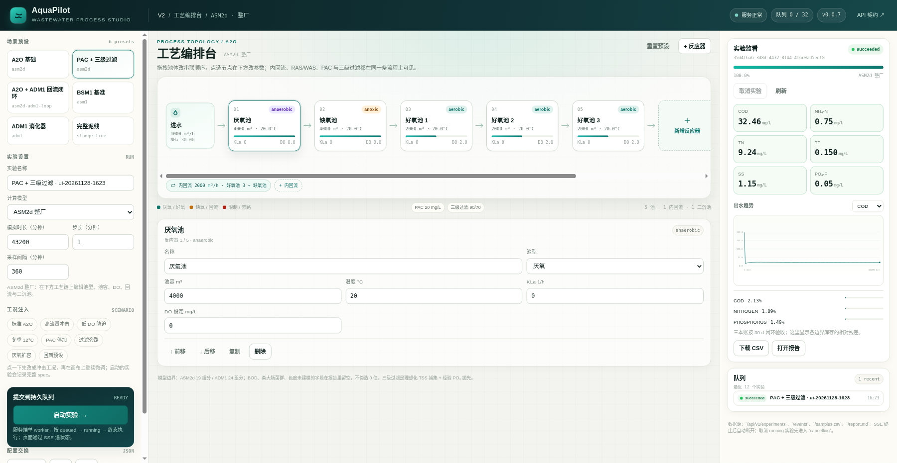
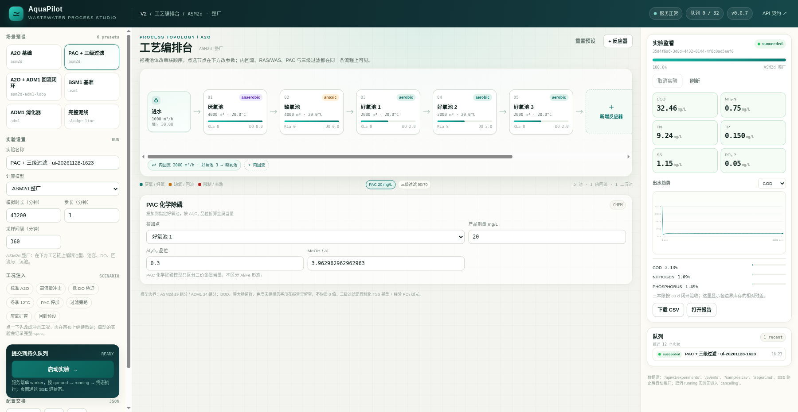
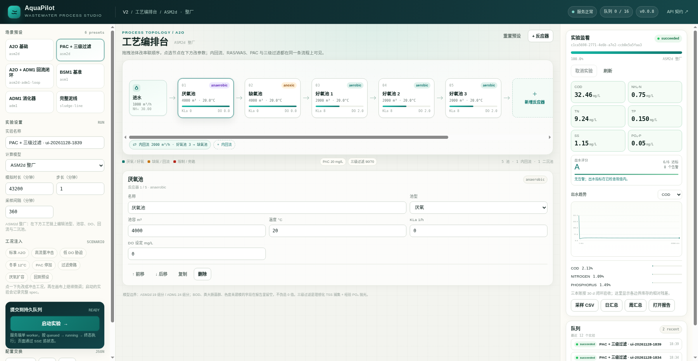
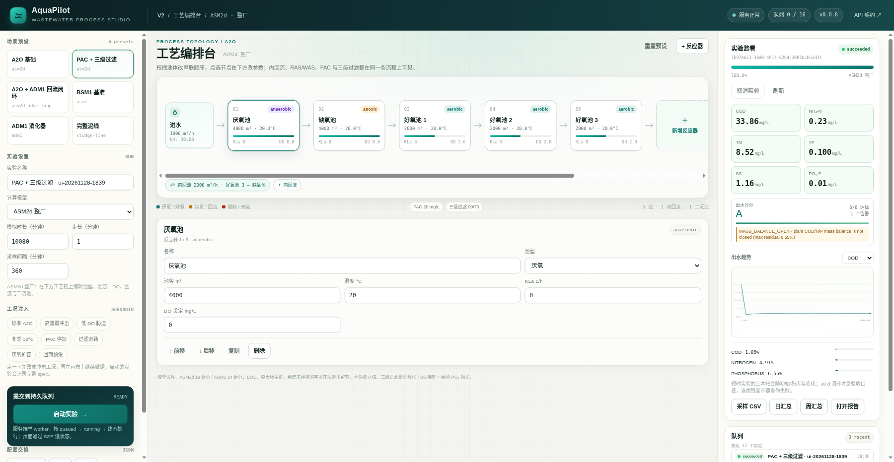
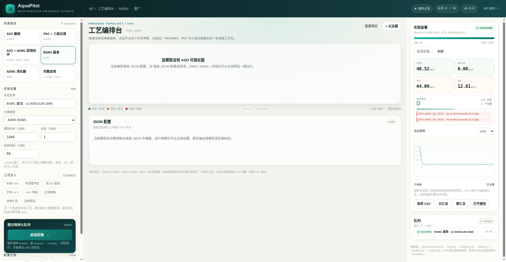
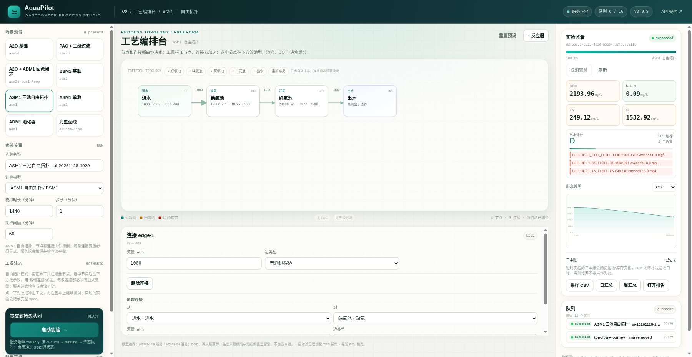
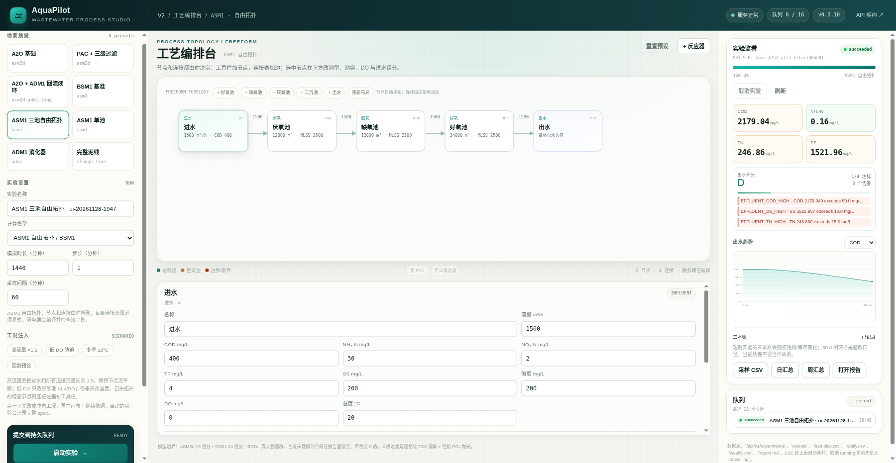
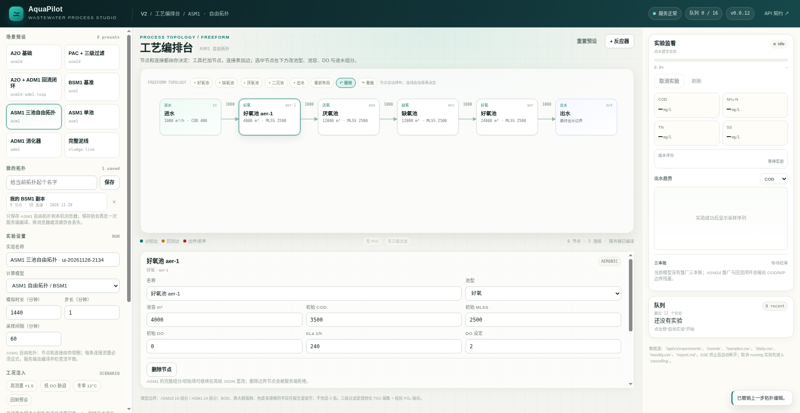
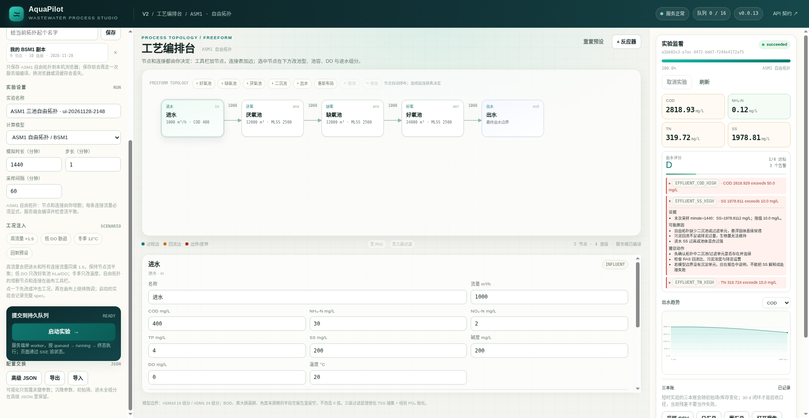
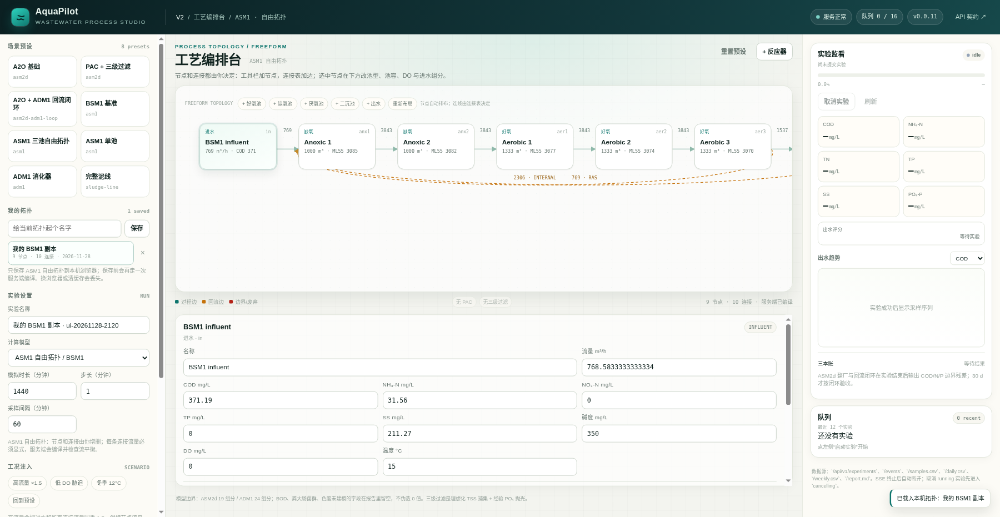

# V2 可视化编排台

> 版本 0.0.13。服务启动后直接打开 `http://127.0.0.1:5173/`。这是 V2-3 之后补上的可交互前端，不是只读仪表盘：A2O 工况可以在画布上改，ASM1 可以增删节点和连接，提交后进入同一条持久实验队列。















## 1. 之前为什么没有前端

V2-3 的交付顺序是后端优先：先把实验请求、持久队列、worker、SSE、CSV/Markdown 和取消/恢复做成可测试的服务，再补界面。V2-3 的服务 router 当时只有 API，没有 `/` 路由；用户只能自己拼完整 `config` JSON。这是事实，不是“已经做了但没展示”。

现在 `aquapilot-service` 在同一进程内托管单文件页面，页面与 API 同源，不需要 Node 构建链，也没有额外前端进程。可视化层只负责生成和展示 `config`，最终仍由服务端做 422 校验。

## 2. 打开方式

```bash
cd rust-v2
cargo run -q -p aquapilot-cli -- serve \
  --bind 127.0.0.1:5173 \
  --db ./aquapilot.sqlite \
  --queue-capacity 32
```

浏览器打开 `http://127.0.0.1:5173/`。`GET /api/v1/presets` 返回内嵌的 6 个预设；页面首次加载会拉取预设并选中 `PAC + 三级过滤`。

## 3. 能改哪些工况

### 3.1 场景预设

| preset id | 模型 | 用途 |
| --- | --- | --- |
| `a2o-basic` | `asm2d` | A2O 基础，无 PAC、无三级过滤 |
| `a2o-pac-tertiary` | `asm2d` | PAC 20 mg/L + 三级过滤 |
| `a2o-loop` | `asm2d-adm1-loop` | A2O 与 ADM1 泥线回流闭环，泥线用默认配置 |
| `bsm1` | `asm1` | BSM1 基准 |
| `adm1` | `adm1` | ADM1 消化器教程参数 |
| `sludge-line` | `sludge-line` | 浓缩 + 消化 + 脱水 + 沼气 + 滤液 |

### 3.2 画布上的直接编辑

只对 `asm2d` 和 `asm2d-adm1-loop` 展开 A2O 工艺链；`asm1`、`adm1`、`sludge-line` 用高级 JSON。

- **反应器**：点选池体，在下方改名称、池型（厌氧/缺氧/好氧）、池容、温度、KLa、DO 设定；支持拖拽改串联顺序、新增、复制、删除、前移/后移。
- **二沉池**：面积、深度、层数、进料层、RAS 回流到哪个反应器、RAS/WAS 流量。
- **内回流**：点击画布下方回流胶囊，改起点、终点和流量；`+ 内回流` 可新增一条，删除后不会留下悬空端点。拖拽或前移/后移池体会同步重映射回流端点、RAS 回流点和 PAC 投加点。
- **PAC**：点画布下方 `PAC` 胶囊进入面板，改投加点（只能选好氧池）、产品剂量、Al₂O₃ 品位、MeOH/Al。
- **三级过滤**：点 `三级过滤` 胶囊进入面板，改 TSS 去除率、PO₄ 去除率；旁路就是把两个去除率设为 0。
- **进水**：流量、NH₄-N、PO₄-P、易降解 COD、发酵产物、惰性 COD、慢速 COD、惰性颗粒、异养菌 XH。
- **运行参数**：模型、模拟时长、步长、采样间隔、泥线天数、实验名称。

### 3.3 一键工况注入

画布上方/左侧的 scenario chips 会直接改当前 `plant`：

- 高流量冲击：进水 1500 m³/h；
- 低 DO 胁迫：好氧池 KLa 120、DO 1.0；
- 冬季 12 °C：所有反应器温度 12 °C；
- PAC 停加：PAC 剂量 0；
- 过滤旁路：三级过滤两个去除率 0；
- 厌氧扩容：首池池容 6000 m³；
- 回到预设：重新载入当前 preset。

注入后画布、校验和提交的 `config` 同步变化；不是只改前端标签。

### 3.4 高级 JSON

`高级 JSON` 打开当前完整 `config`：

- 可视化模型接受 `{ "plant": {...} }` 或直接 `{ "reactors": [...] }`；
- ADM1/泥线的完整参数在 JSON 中编辑；ASM1 画布只暴露常用字段，沉降参数、初始场和完整组分仍在 JSON 中；
- 支持导出 `{model, config}`、导入同结构文件；
- 服务端仍按 `ExperimentRequest` 做 422 校验，前端不替服务端放行。

### 3.5 ASM1 自由拓扑画布

左侧 `ASM1 三池自由拓扑` 或 `ASM1 单池` 预设会切到自由拓扑模式，A2O 工况 chips 替换为自由拓扑工况：

- `高流量 ×1.5`：进水与所有连接流量同乘 1.5，节点流平衡不变；
- `低 DO 胁迫`：所有好氧池 KLa=120、DO 设定=1.0；
- `冬季 12°C`：进水与反应器初始温度改 12°C；
- `回到预设`：重新载入当前 preset。

- 画布按前向边自动分层排布；工具栏 `+ 好氧池 / + 缺氧池 / + 厌氧池 / + 二沉池 / + 出水` 增节点；
- 选中节点后在下方编辑名称、池型、池容、初始 COD/MLSS/DO、KLa、DO 设定；进水节点可编辑流量与 COD/NH₄-N/NO₃-N/TP/SS/碱度/DO/温度；二沉池可编辑面积、深度、层数、进料层；
- 删除节点会同时删除它的所有连接；进水和出水边界不可删；
- “新增连接”表单可指定起点、终点、显式流量和边类型（普通过程边/内回流/RAS/WAS）；回流边画成琥珀色虚线，并作为 back-edge 不参与前向拓扑排序；
- 每次修改先本地检查（唯一进/出水、正流量、非回流边不成环等），再异步调用 `POST /api/v1/topologies/validate`；底部状态栏显示“服务端已编译”或具体编译错误。工况注入同样先本地检查再走服务端编译，不绕过拓扑校验；
- 提交仍走同一个 `POST /api/v1/experiments`，服务端会再编译一次；前端不替服务端放行。

浏览器实测：三池预设中删除厌氧池，补一条 `in → anx 1000 m³/h`，得到 4 节点 / 3 连接 / 2 反应器，服务端编译成功；1 d 实验 `succeeded`，评分卡严格按 ASM1 四项打分（D、1/4），并给出 COD/SS/TN 三条超标告警。因为没有二沉池，SS 穿透被如实显示，而不是被评分卡掩盖。

### 3.6 本机拓扑库

自由拓扑画布上方有“我的拓扑”：输入名字点保存，当前拓扑会先走本地检查和服务端编译，再写入浏览器 `localStorage`；列表可载入、删除，最多 12 个。它只存在本机浏览器，不冒充服务端持久化；换浏览器或清缓存会丢失。

### 3.7 拓扑撤销/重做

ASM1 画布的工具栏有 `↶ 撤销` / `↷ 重做`。增删节点、增删连接、工况注入、池型/边类型修改会压入历史栈（最多 50 步）；撤销会恢复节点、连接与选中状态，并重新走服务端编译。切换预设、载入本机拓扑或应用高级 JSON 会清空历史。支持 `Ctrl+Z`、`Ctrl+Shift+Z` / `Ctrl+Y`，输入框内不拦截。



### 3.8 告警解释

告警列表不再只显示代码和一句话：点开每条告警，可以看到证据、可能原因和建议动作。解释来自同一份 `analysis.alarms`，不另做一套前端规则；后端不可用时不会伪造解释。



实测数据落在 `docs/alarm-explain-check.json`：同一实验的 `analysis.alarms[]` 带三段解释，`report.md` 含 `### Alarm explanations`。



## 4. 运行与观测

点“启动实验”后，页面用 `POST /api/v1/experiments` 提交（带 `Idempotency-Key`），随后打开 `GET /api/v1/experiments/{id}/events` 的 SSE：

- 状态 `queued → running → succeeded | failed | cancelled`，running 取消后显示 `cancelling`；
- 成功后展示 COD、NH₄-N、TN、TP、SS、PO₄-P，出水评分卡（A/B/C/D）、告警、三本账残差、CSV 趋势，以及 `samples.csv`、`daily.csv`、`weekly.csv` 和 Markdown 报告入口；
- 评分卡只对出水限值打分；短时三本账未闭合会单独给出 `MASS_BALANCE_OPEN` 告警，不会把 A 伪装成整厂闭环；
- 三本账面板会区分短时实验与 30 d 闭环：短时残差来自初始场/库存变化，不当作失败；
- 队列卡片可回读最近 12 个实验；
- 失败/422 以 toast 展示服务端 `problem+json` 的 `code`、`detail`、`errors`，不伪造成功。

## 5. 边界

- A2O（ASM2d / loop）画布仍是**线性反应器链 + 显式内回流/二沉池回流**，不是任意管道 P&ID；任意分支管网目前只对 ASM1 开放。
- ASM1 画布支持增删节点和连接，但布局是自动分层，不是可拖拽的自由坐标画布；节点 id 由预设/新增自动生成，不能直接改 id。
- ADM1、泥线仍只走高级 JSON，不画节点。
- PAC 仍是三价金属当量模型；三级过滤仍是理想化 TSS 捕集 + 经验 PO₄ 抛光，不含反冲洗、滤料级配和穿透。
- 前端没有鉴权；生产部署需要在外层加反向代理、TLS 和访问控制，V2-3 本身也没有 Bearer/RBAC。
- 页面是单文件、内联 CSS/JS，便于单二进制交付；代价是前端代码不适合做大型组件化扩展。V2-4 若要做完整编排器，应拆出独立前端工程。

## 6. 验收

- 页面由服务真实托管：`GET /` 返回 `text/html`，`GET /api/v1/presets` 返回 8 个 preset；
- 浏览器实测：默认 PAC + 三级过滤 30 天成功，出水 COD 32.46、NH₄-N 0.75、TN 9.24、TP 0.150、SS 1.15、PO₄-P 0.05 mg/L；三本账 COD/N/P 2.13% / 1.09% / 1.49%；评分卡 A、6/6 达标、0 告警；`daily.csv` 30 行、`weekly.csv` 5 行；
- 同页切换 BSM1 预设，9 节点 / 10 连接（含 RAS 与内回流）在自由拓扑画布中编译成功；1 天实验成功；
- 场景注入与新增反应器已在浏览器中验证，校验从 `5 池 · 1 内回流 · 1 二沉池` 变为 `6 池 · 1 内回流 · 1 二沉池`；
- PAC 面板改为数字索引（投加点 2）、剂量 25 mg/L；二沉池 RAS 回流点改为好氧池 3（索引 4）；1 天实验提交成功，未出现 422，说明 select→number 的绑定已生效；
- `+ 内回流` 新增 4→1 回流、删除恢复；厌氧池后移后校验仍为 `5 池 · 1 内回流 · 1 二沉池`，回流端点随池序重映射；
- 7 d 实验评分卡 A、6/6 达标，但 `MASS_BALANCE_OPEN` 残差 6.55%；`daily` 7 行、`weekly` 1 行，证明边界样本不会被拆成第 8 天/第 2 周。
- BSM1/ASM1 1 d 实测：只显示 COD/NH4-N/TN/SS 四项，评分 D、2/4 达标，`EFFLUENT_SS_HIGH` 与 `EFFLUENT_TN_HIGH` 两个告警；页面不显示 TP/PO4 假通过。
- 代表性端到端矩阵见 `docs/coverage-matrix.json`：11/11 通过，覆盖 5 个模型 + 5 个工况，93.386 s；loop 30 天单例 72.101 s，最大三本账残差 2.85%。
- 五条角色旅程见 `docs/journeys-v2.json`：5/5 通过，覆盖暴雨、风机故障、三级过滤开/关、7 d 周报、脏数据；仍明确 `completed_24h=false`。
- 自由拓扑验收旅程见 `docs/topology-journey.json`：3 个 ASM1 预设全部 200 编译；删除厌氧池并补 `in → anx` 后 4 units / 3 connections 编译成功；1 d 实验 succeeded，D、1/4，三条出水告警；`completed_24h=false`。截图见 `screenshots/v2-ui-topology.png`。 0.0.10 自由拓扑工况验收见 `docs/topology-scenario-check.json`：高流量 ×1.5 编译 200、进水/出水 1500 m³/h、1 d 实验 succeeded、D 1/4、三条出水告警；低 DO 与冬季 12°C 编译 200。截图见 `screenshots/v2-ui-topology-scenarios.png`。
