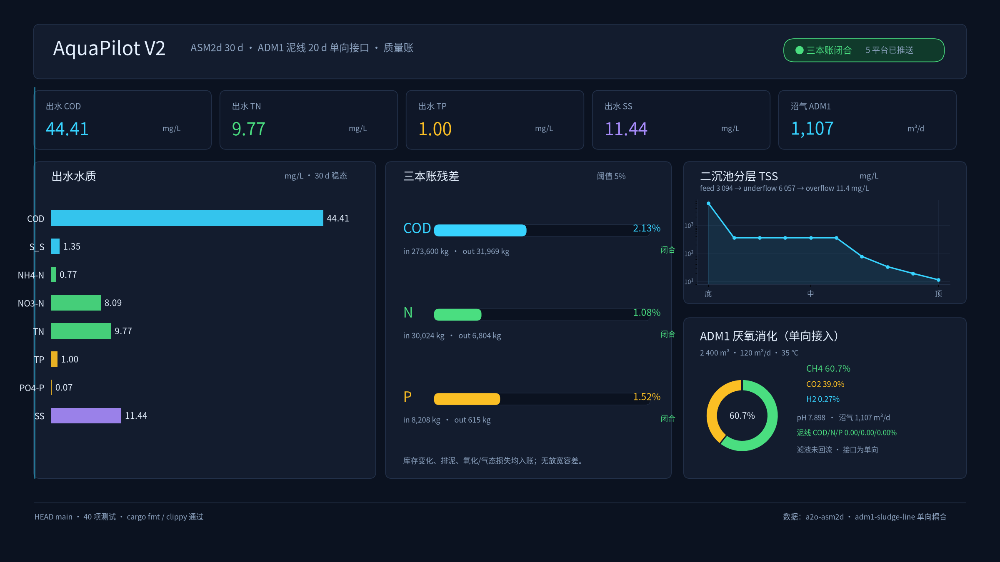
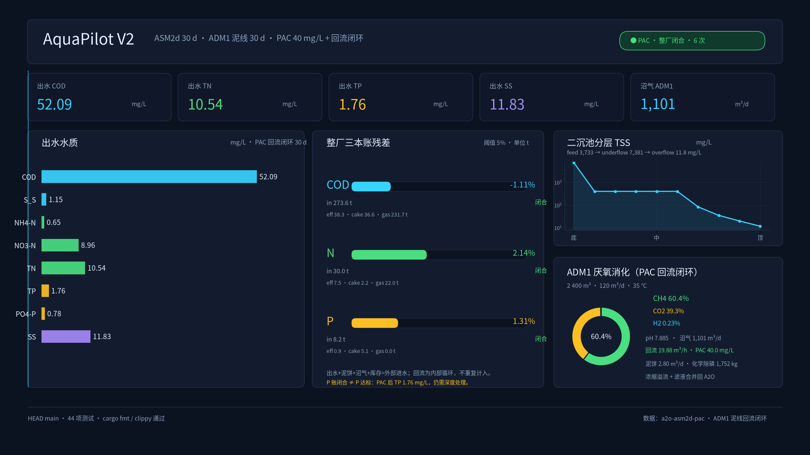
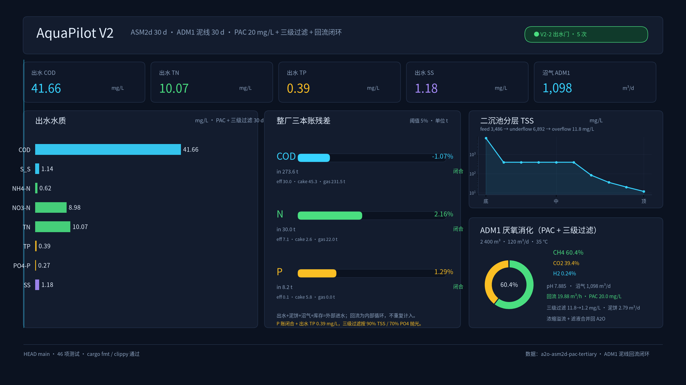

# AquaPilot v2（clean-room Rust）

这是 AquaPilot 的**新一代实现**，不是旧 TypeScript 仿真内核的逐函数翻译。

- 设计原则与阶段计划：`../docs/ROADMAP-V2.md`
- Clean-room 规则：`../docs/CLEAN-ROOM.md`
- 旧 `rust/` 已冻结为 v0.11.23 的历史 checkpoint，v2 不读取、不复制它的源码。

## 当前状态：V2-1、V2-2 已完成；V2-3 服务骨架已落地，24 h soak 待跑

V2-1 已完成并推送：ASM1 五池整厂、Takács 10 层二沉池、RAS/内回流/WAS、DO 控制、BSM1-like 与官方 BSM1 对照、22 项测试。

V2-2 当前已落：

- `aquapilot-model::asm2d`：19 组分（18 个独立动力学状态 + 由颗粒组分导出的 `X_TSS`）、21 个 ASM2d 过程、公开化学计量矩阵与速率方程；
- `aquapilot-model::asm2d_plant`：A2O 整厂路径（厌氧/缺氧/多级好氧 + 二沉池 + RAS/内回流/WAS），30 天稳定运行，CLI `asm2d` 可执行；支持 PAC 投加到指定反应器，按 Al2O3 品位换算 Al，再映射为 ASM2d `X_MeOH` 当量；
- ASM2d 质量账：A2O fixture 30 天的 COD/N/P 三本账均闭合（残差分别为 2.13% / 1.09% / 1.52%）；
- 多系列：`aquapilot-model::asm2d_parallel` 支持多个独立 A2O 系列并行运行并汇总全厂出水与三本账；`a2o-asm2d-2train.json` 为 2×500 m3/h 示例，系列各自拥有二沉池、RAS/WAS；
- `aquapilot-model::adm1`：24 个动力学组分 + 2 个强离子状态、22 个过程、强离子 pH/电荷平衡、准稳态气相、COD/N 双账；10 天 tutorial 残差 -0.01% / -0.00%；
- `aquapilot-model::adm1_sludge`：重力浓缩 + ADM1 消化 + 机械脱水 + 沼气 + 磷示踪的独立泥线，20 天 COD/N/P 账残差 0.00% / 0.00% / 0.00%；
- `aquapilot-model::asm2d_sludge`：ASM2d 与 ADM1 的双向翻译，A2O 二沉池底流按 COD/N/P 守恒进入泥线，泥线回流液按 COD/N/P 守恒翻回 ASM2d；CLI `asm2d-sludge` 可跑单向接入；
- `aquapilot-model::asm2d_adm1_loop`：把浓缩溢流与滤液合并后接回 A2O 进水，successive substitution 迭代到回流状态稳定；整厂 COD/N/P 三本账以外部进水为输入，出水、泥饼、沼气、库存为输出；CLI `asm2d-loop`；
- PAC 基础投加：`Asm2dPacConfig` 指定反应器、产品剂量、Al2O3 品位和金属氢氧化物当量；`asm2d`/`asm2d-loop` 支持 `--pac-dose`、`--pac-reactor`、`--pac-al2o3-fraction`；`fixtures/a2o-asm2d-pac.json` 为 40 mg/L 示例；
- 三级过滤：`Asm2dTertiaryConfig` 在二沉池后按颗粒物捕集率去除 TSS/颗粒 COD/N/P，并可选 PO4 化学抛光；CLI 支持 `--tertiary-tss-removal`、`--tertiary-po4-removal`；`fixtures/a2o-asm2d-pac-tertiary.json` 为 PAC 20 mg/L + 90% TSS + 70% PO4 示例；
- V2-3 服务骨架：`aquapilot-service` 已实现 Axum HTTP、SSE 状态流、SQLite 持久实验队列、OpenAPI 3.1、RFC 9457、幂等键、取消/恢复、CSV/Markdown 报告；CLI `serve` 启动单二进制服务；
- 尚未完成：24 h soak（仅跑过 60 s smoke）、WebSocket（当前用 SSE）、Bearer 角色鉴权、MCP、界面；PAC 仍为三价金属当量模型，三级过滤为理想化边界单元。

30 天 A2O ASM2d 实测（`fixtures/a2o-asm2d.json`）：

| 指标 | 实测 |
| --- | --- |
| 出水 COD | 44.41 mg/L |
| 出水 S_S | 1.347 mg/L |
| 出水 NH4-N | 0.771 mg/L |
| 出水 NO3-N | 8.094 mg/L |
| 出水 TN | 9.767 mg/L |
| 出水 TP | 1.004 mg/L |
| 出水 SS | 11.44 mg/L |
| 二沉池 feed / underflow / overflow TSS | 3093.95 / 6056.61 / 11.44 mg/L |
| COD 账残差 | 2.13%（closed） |
| N 账残差 | 1.09%（closed） |
| P 账残差 | 1.52%（closed） |

两系列各 500 m3/h、反应器与二沉池按 1/2 缩放后，汇总出水与三本账残差与单系列一致，证明多系列汇总路径可用。

回流闭环 30 天实测（`asm2d-loop`，浓缩溢流 + 滤液合并回流）：

| 指标 | 实测 |
| --- | --- |
| 迭代 / 回流 | 4 次收敛，19.884 m3/h |
| 回流 COD / N / P | 1366.3 / 202.709 / 160.359 mg/L |
| A2O 出水 COD / TN / TP / SS | 53.61 / 10.587 / 3.872 / 11.69 mg/L |
| 消化 pH / 沼气 / CH4 | 7.884 / 1093.6 m3/d / 60.4% |
| 泥饼 / 滤液 | 2.78 m3/d / 117.22 m3/d |
| 整厂 COD / N / P 残差 | -1.03% / 2.19% / 0.71%，均 closed |

60 天稳态检查：整厂 COD / N / P 残差 -1.64% / 1.15% / 0.40%，均 closed；A2O 出水 TP 3.555 mg/L。P 质量账已闭环，但单靠生物除磷出水 TP 仍高。

PAC 40 mg/L 回流闭环 30 天实测（`fixtures/a2o-asm2d-pac.json`）：

| 指标 | 实测 |
| --- | --- |
| 迭代 / 回流 | 6 次收敛，19.883 m3/h |
| PAC 产品 / Al / X_MeOH 当量 | 979.1 / 155.5 / 616.2 kg/d |
| 净化学除磷 | 1,751.8 kg / 30 d |
| A2O 出水 COD / TN / TP / SS | 52.09 / 10.541 / 1.760 / 11.83 mg/L |
| 消化 pH / 沼气 / CH4 | 7.885 / 1101.3 m3/d / 60.4% |
| 泥饼 / 滤液 | 2.80 m3/d / 117.20 m3/d |
| 整厂 COD / N / P 残差 | -1.11% / 2.14% / 1.31%，均 closed |

PAC 把回流闭环的出水 TP 从 3.872 压到 1.760 mg/L，降幅约 55%；但 1.760 仍高于常见排放限值，且 PAC 模型使用 ASM2d 默认三价金属（Fe(OH)3/FePO4）质量系数，未区分 Al/Fe 形态。因此这只是 PAC 基础投加与化学除磷，不是“TP 达标”或完整 V2-2 验收。

PAC 20 mg/L + 三级过滤（90% TSS、70% PO4 抛光）回流闭环 30 天实测（`fixtures/a2o-asm2d-pac-tertiary.json`）：

| 指标 | 实测 |
| --- | --- |
| 迭代 / 回流 | 5 次收敛，19.884 m3/h |
| PAC 产品 / Al / X_MeOH 当量 | 489.5 / 77.8 / 308.1 kg/d |
| 净化学除磷 | 1,059.0 kg / 30 d |
| 三级过滤 TSS / PO4 捕集 | 11.77 → 1.18 mg/L；PO4 抛光 126.6 kg/30 d |
| A2O 出水 COD / NH4-N / TN / TP / SS | 41.66 / 0.617 / 10.073 / 0.387 / 1.18 mg/L |
| 消化 pH / 沼气 / CH4 | 7.885 / 1,098 m3/d / 60.4% |
| 泥饼 / 滤液 | 2.79 m3/d / 117.21 m3/d |
| 整厂 COD / N / P 残差 | -1.07% / 2.16% / 1.29%，均 closed |

三级过滤把回流闭环的 TP 从 PAC 40 的 1.760 进一步压到 0.387 mg/L；COD 41.66、SS 1.18、NH4-N 0.617、TN 10.073 也低于 GB 18918 一级 A 的常见限值（COD 50、SS 10、NH4-N 5、TN 15、TP 0.5）。BOD、粪大肠菌群、色度等未建模，不能宣称全指标合规。

V2-2 出水门按“关键指标 + 三本账闭合”验收通过；三级过滤是理想化颗粒捕集 + 经验 PO4 抛光效率，没有滤池反冲洗水力学、滤料级配和 Al/Fe 形态区分。捕集固体与抛光 P 计入 `waste_kg`，整厂 `cake_kg` 含滤饼，不等同于泥线脱水机泥饼。







## 运行

服务（HTTP + SSE，默认 `127.0.0.1:5173`）：

```bash
cd rust-v2
cargo run -q -p aquapilot-cli -- serve --bind 127.0.0.1:5173 --db ./aquapilot.sqlite --queue-capacity 32
```

API 契约见 [`../docs/V2-API.md`](../docs/V2-API.md)。60 s soak smoke：

```bash
cd ..
python3 scripts/soak_v2.py --duration 60 --interval 2
```

24 h soak 尚未执行；不要用 smoke 结果冒充 24 h 验收。

仿真 CLI：

```bash
cd rust-v2
cargo run -p aquapilot-cli -- validate fixtures/single-aerobic.json
cargo run -p aquapilot-cli -- simulate fixtures/single-aerobic.json --minutes 1440
cargo run -p aquapilot-cli -- simulate fixtures/three-stage.json --minutes 1440 --out /tmp/three-stage.json
cargo run -p aquapilot-cli -- simulate fixtures/bsm1-like.json --minutes 43200 --params default --out /tmp/bsm1-30d.json
cargo run -p aquapilot-cli -- simulate fixtures/bsm1-official.json --minutes 43200 --params bsm1 --out /tmp/bsm1-official-30d.json
cargo run -p aquapilot-cli -- simulate fixtures/bsm1-calibrated.json --minutes 43200 --params bsm1-cal --out /tmp/bsm1-calibrated-30d.json
cargo run -p aquapilot-cli -- asm2d fixtures/a2o-asm2d.json --minutes 43200 --out /tmp/a2o-asm2d-30d.json
cargo run -p aquapilot-cli -- asm2d-parallel fixtures/a2o-asm2d-2train.json --minutes 43200 --out /tmp/a2o-asm2d-2train.json
cargo run -p aquapilot-cli -- adm1 fixtures/adm1-tutorial.json --days 10 --dt 0.002 --out /tmp/adm1.json
cargo run -p aquapilot-cli -- sludge-line fixtures/adm1-sludge-line.json --days 20 --dt 0.002 --out /tmp/adm1-sludge.json
cargo run -p aquapilot-cli -- asm2d-sludge fixtures/a2o-asm2d.json --minutes 43200 --sludge-days 20 --out /tmp/a2o-sludge.json
cargo run -p aquapilot-cli -- asm2d-loop fixtures/a2o-asm2d.json --minutes 43200 --dt 1 --sludge-days 30 --sludge-dt 0.002 --max-iterations 6 --relaxation 1.0 --out /tmp/a2o-loop.json
cargo run -p aquapilot-cli -- asm2d fixtures/a2o-asm2d-pac.json --minutes 43200 --out /tmp/a2o-pac.json
cargo run -p aquapilot-cli -- asm2d-loop fixtures/a2o-asm2d-pac.json --minutes 43200 --dt 1 --sludge-days 30 --sludge-dt 0.002 --max-iterations 6 --relaxation 1.0 --out /tmp/a2o-loop-pac.json
cargo run -p aquapilot-cli -- asm2d fixtures/a2o-asm2d-pac-tertiary.json --minutes 43200 --out /tmp/a2o-pac-tertiary.json
cargo run -p aquapilot-cli -- asm2d-loop fixtures/a2o-asm2d-pac-tertiary.json --minutes 43200 --dt 1 --sludge-days 30 --sludge-dt 0.002 --max-iterations 8 --relaxation 1.0 --out /tmp/a2o-loop-pac-tertiary.json
```

质量门：

```bash
cargo fmt --all --check
cargo clippy --workspace --all-targets -- -D warnings
cargo test --workspace
```

## 目录

```text
rust-v2/
├── crates/aquapilot-domain
├── crates/aquapilot-model
├── crates/aquapilot-engine
├── crates/aquapilot-service
├── crates/aquapilot-cli
└── fixtures/
```

## 边界

- 单池和串联池都是固定体积 CSTR；入流按流量加权混合；出流按显式连接流量计。
- `dt` 上限 1 min；负值/非有限值在物理下界钳制并输出 `ASM1_STATE_CLAMPED` 诊断。
- 二沉池是 10 层有限体积 Takács 风格模型；RAS 底流按缺氧处理（DO 置 0），WAS 进沉泥汇。
- ASM1 COD 账只做到“进水/出水/排泥/库存变化/未解释项”，氧化项尚未入账，因此**不声称闭合**。
- ASM2d A2O、ADM1 泥线、PAC + 三级过滤回流闭环的整厂 COD/N/P 三本账在 30 天 fixture 均闭合；闭合是质量账闭合，不等于全指标合规。
- PAC 以产品 Al2O3 品位换算 Al，再按 `107/27` 映射为 `X_MeOH` 当量；化学沉淀沿用 ASM2d 默认 `3.45 g X_MeOH / g P` 与 `4.87 g X_MeP / g P` 系数。未区分 Al/Fe 形态。
- 三级过滤按固定 TSS 捕集率与经验 PO4 抛光效率计算，捕集固体计入 `waste_kg`；未建模反冲洗水、滤料级配和过滤压头，不能当作详细滤池设计。
- 服务是单进程、单 worker 的持久队列；`asm2d-adm1-loop`/`adm1`/`sludge-line` 的模型调用不可中断，运行中取消只能在当前运行结束后收口。
- 服务首版无 Bearer/RBAC、无 MCP、无 WebSocket；实时状态用 SSE `/api/v1/experiments/{id}/events`。
- 未完成：24 h soak、界面、工业接口；官方 BSM1 参数集仍未全部通过 Table 6，只有校准候选在 ±20% 内通过。
